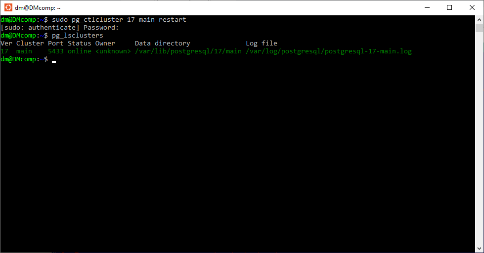
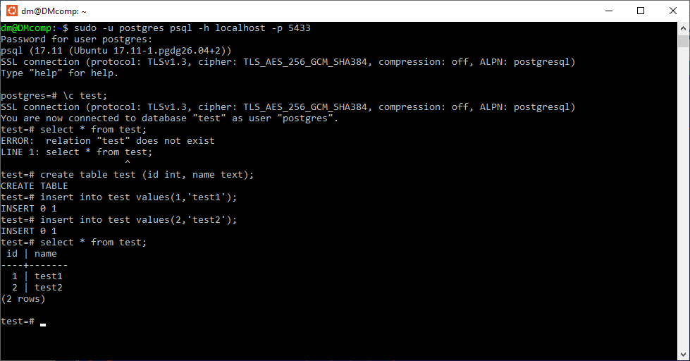
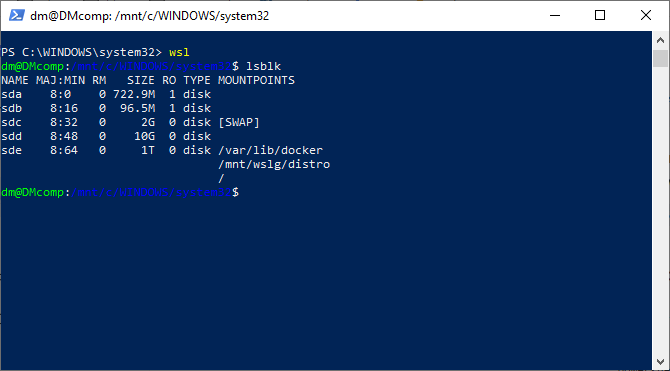
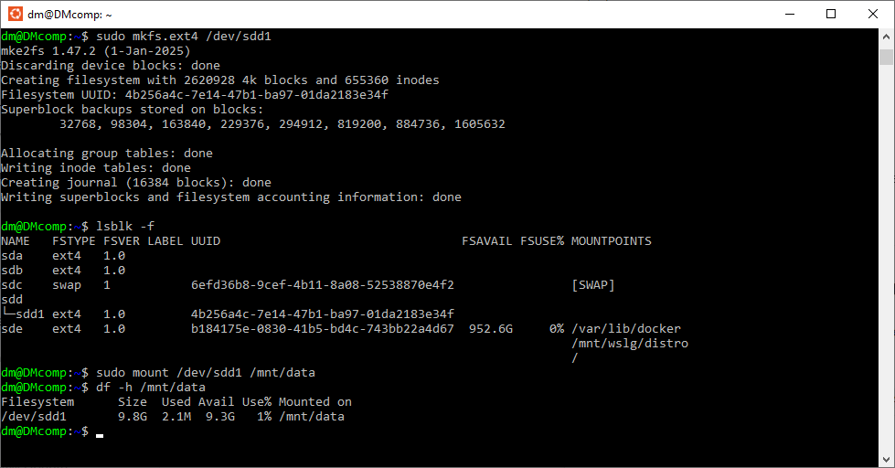
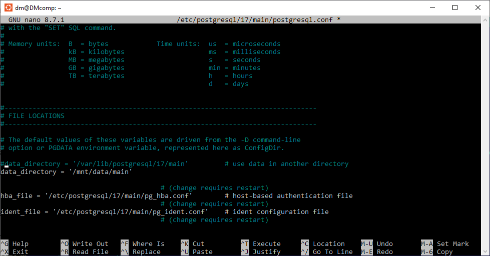
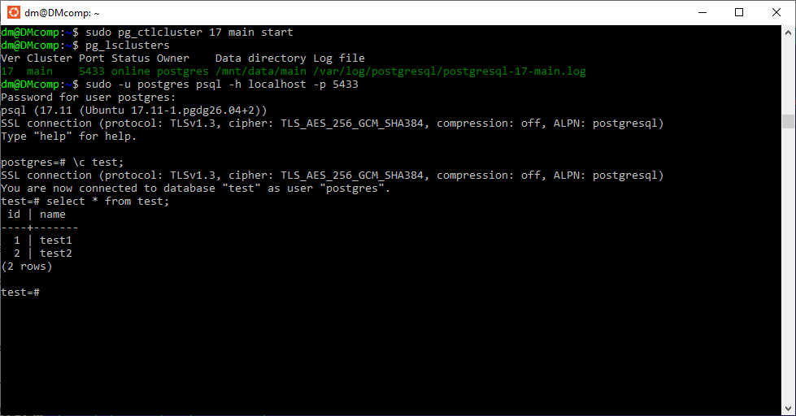

## Физический уровень PostgreSQL // ДЗ 2
постановка задачи на https://otus.ru/learning/531261/

# 1. Создайте виртуальную машину с Ubuntu 22.04/24.04 LTS в ЯО/VirtualBox (или эквивалентный стенд с возможностью подключать диск);

воспользуемся наработками прошлой Домашней работы.
запустим ранее установленный WSL c Ubuntu 

# 2. Установите PostgreSQL через apt;

PostgreSQL через apt так же разварачивался 
использвались команды

```sh
sudo apt install -y postgresql-common
sudo /usr/share/postgresql-common/pgdg/apt.postgresql.org.sh
sudo apt install -y postgresql-17
sudo nano /etc/postgresql/17/main/postgresql.conf
```

# 3. Проверьте, что кластер запущен (pg_lsclusters);

перестартуем и проверим кластер

```sh
sudo pg_ctlcluster 17 main restart
pg_lsclusters
```


# 4. Под пользователем postgres подключитесь в psql, создайте таблицу test и добавьте 1–2 строки;

```sql
sudo -u postgres psql -h localhost -p 5433
create database test;
\c test;
create table test (id int, name text);
insert into test values(1,'test1');
insert into test values(2,'test2');
select * from test;
\q
```



# 5. Остановите кластер PostgreSQL штатной командой (pg_ctlcluster ... stop);

```sh
sudo pg_ctlcluster 17 main stop
pg_lsclusters
Ver Cluster Port Status Owner    Data directory              Log file
17  main    5433 down   postgres /var/lib/postgresql/17/main /var/log/postgresql/postgresql-17-main.log
```

# 6. Создайте дополнительный диск 10 GB и подключите его к виртуальной машине;

воспользуемся DiskPart из под командной строки с правами администратора

```cmd
diskpart
create vdisk file="C:\wsl\pgdata.vhdx" maximum=10240 type=expandable
Microsoft DiskPart, версия 10.0.19041.964
DISKPART> create vdisk file="C:\wsl\pgdata.vhdx" maximum=10240 type=expandable
  Завершено (в процентах): 100
Файл виртуального диска успешно создан с помощью программы DiskPart.
takeown /f "C:\WSL\pgdata.vhdx"
```

Подмонтируем созданный диск к WSL

```PowerShell
wsl --mount --vhd "C:\wsl\pgdata.vhdx" --bare
```



# 7. Разметьте диск, создайте файловую систему и примонтируйте, например, в /mnt/data;

создаем на диске таблицу разделов, создаем раздел на весь диск, 
создаем файловую систему ext4, создаем точку монтирования и 
монтируем раздел

```sh
sudo parted /dev/sdd mklabel gpt 
sudo parted /dev/sdd mkpart primary ext4 0% 100%
sudo mkfs.ext4 /dev/sdd1
sudo mkdir -p /mnt/data
sudo mount /dev/sdd1 /mnt/data
```



# 8. Настройте автомонтирование после перезагрузки (через fstab) и проверьте, что диск остаётся примонтированным;

узнаем UUID
```sh
sudo blkid /dev/sdd1
/dev/sdd1: UUID="4b256a4c-7e14-47b1-ba97-01da2183e34f" BLOCK_SIZE="4096" TYPE="ext4" PARTLABEL="primary" PARTUUID="a355356f-3e4f-482a-8cd1-7b832aaaa6d9"
sudo nano /etc/fstab
```

внесем запись в fstab
```sh
UUID="4b256a4c-7e14-47b1-ba97-01da2183e34f"  /mnt/data  ext4  defaults,nofail  0  2
```
перезапуск WSL
```PowerShell
wsl --mount --vhd "C:\wsl\pgdata.vhdx" --bare
```

проверка
```sh
df -h /mnt/data
Filesystem      Size  Used Avail Use% Mounted on
/dev/sdd1       9.8G  2.1M  9.3G   1% /mnt/data
```

# 9. Назначьте владельцем каталога /mnt/data пользователя postgres;

```sh
sudo chown -R postgres:postgres /mnt/data
```

# 10. Перенесите каталог данных PostgreSQL с текущего пути на /mnt/data (с сохранением прав);

```sh
pg_lsclusters
Ver Cluster Port Status Owner     Data directory              Log file
17  main    5433 down <unknown> /var/lib/postgresql/17/main /var/log/postgresql/postgresql-17-main.log
sudo rsync -av /var/lib/postgresql/17/main/ /mnt/data/main/
```

сохраним старый каталог как резервную копию

```sh
sudo mv /var/lib/postgresql/17/main /var/lib/postgresql/17/main.bak
```

# 11. Попробуйте запустить кластер; зафиксируйте результат и причину (если не стартовал);

```sh
 sudo pg_ctlcluster 17 main start
Error: /var/lib/postgresql/17/main is not accessible or does not exist
```

# 12. Найдите в конфигурации /etc/postgresql/версия/main параметр, который указывает на каталог данных, измените его на новый путь и объясните изменение;

```sh
sudo nano /etc/postgresql/17/main/postgresql.conf
```

ремарим старый путь до каталога с данными, прописываем новый. берем данные из нового источника

```sh
#data_directory = '/var/lib/postgresql/17/main'         # use data in another directory
data_directory = '/mnt/data/main'
```



# 13. Запустите кластер повторно;

```sh
sudo pg_ctlcluster 17 main start
pg_lsclusters
Ver Cluster Port Status Owner    Data directory Log file
17  main    5433 online postgres /mnt/data/main /var/log/postgresql/postgresql-17-main.log
```

# 14. Подключитесь через psql и проверьте, что таблица test и данные сохранились;

```sh
sudo -u postgres psql -h localhost -p 5433
```
```sql
\c test;
select * from test;
```



#Цель работы - перенести каталог данных PostgreSQL на дополнительный диск, достигнута.
