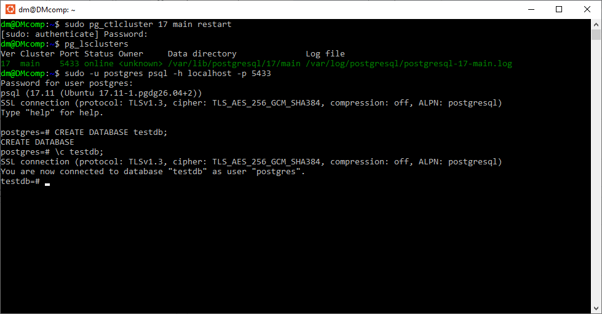
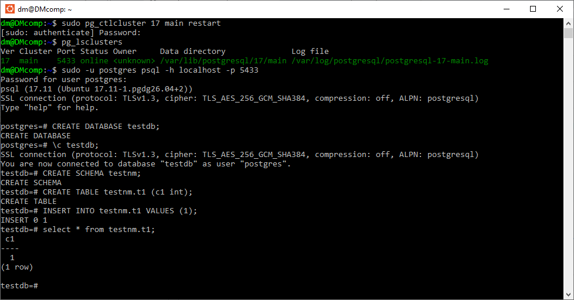
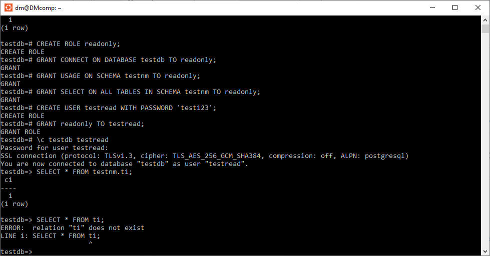

# Логический уровень PostgreSQL // ДЗ 3
постановка задачи на https://otus.ru/learning/531261/

## 1. Создайте кластер PostgreSQL 17 и базу testdb;

перезапустим кластер и проверии его статус
```sh
sudo pg_ctlcluster 17 main restart
pg_lsclusters

 Ver Cluster Port Status Owner    Data directory              Log file
 17  main    5433 online postgres /var/lib/postgresql/17/main /var/log/postgresql/postgresql-17-main.log
```

подключимся к кластеру и создадим базу и откроем к ней соединение
```sh
sudo -u postgres psql -h localhost -p 5433
```

```sql
CREATE DATABASE testdb;
\c testdb; #  connected to database "testdb" as user "postgres".
```


## 2. Создайте схему testnm, таблицу t1(c1 int) и вставьте строку;

```sql
CREATE SCHEMA testnm;
CREATE TABLE testnm.t1 (c1 int);
INSERT INTO testnm.t1 VALUES (1);
```

получили структуру
 DATABASE:testdb
  \ SCHEMA:testnm
     \ TABLE:t1

проверим выборкой

```sql
select * from testnm.t1;

  c1
 ----
   1
 (1 row)
```


## 3. Создайте роль readonly, выдайте ей CONNECT к testdb, USAGE на testnm, SELECT на таблицы схемы testnm;

```sql
CREATE ROLE readonly;
GRANT CONNECT ON DATABASE testdb TO readonly;
GRANT USAGE ON SCHEMA testnm TO readonly;
GRANT SELECT ON ALL TABLES IN SCHEMA testnm TO readonly;
```

## 4. Создайте пользователя testread/test123, назначьте роль readonly, выполните select * from t1; и зафиксируйте результат;

```sql
CREATE USER testread WITH PASSWORD 'test123';
GRANT readonly TO testread;
```

переключимся на пользователя testread и проведем выборку

```sql
\c testdb testread #  connected to database "testdb" as user "testread".

SELECT * FROM testnm.t1;

  c1
 ----
   1
 (1 row)

SELECT * FROM t1;
 ERROR:  relation "t1" does not exist
 LINE 1: select * from t1;
                       ^
```
обращение к таблице без указания схемы приводит к ошибке, исправим в следующем пункте



## 5. Пересоздайте таблицу как testnm.t1, проверьте select * from testnm.t1; и настройте поведение, чтобы обращение к t1 было предсказуемым;

```sql
\c testdb postgres

DROP TABLE testnm.t1;
CREATE TABLE testnm.t1 (c1 int);
INSERT INTO testnm.t1 VALUES (1);

\c testdb testread

SELECT * FROM testnm.t1;
 ERROR:  permission denied for table t1
```
после пересоздания ранее выданные права таке же удалились

```sql
SELECT * FROM t1;
 ERROR:  relation "t1" does not exist
 LINE 1: SELECT * FROM t1;
```
обращение к таблице без указания схемы попрежнему приводит к ошибке, исправим ниже.

повторно дадим парава на чтение 
и что бы не повторять это каждый раз при создании каждой таблицы изменим привелегии
```sql
\c testdb postgres
GRANT SELECT ON testnm.t1 TO readonly;
ALTER DEFAULT PRIVILEGES IN SCHEMA testnm GRANT SELECT ON TABLES TO readonly;
```

настроим возможность пользователю обращатся к таблице t1 без указания схемы
```sql
ALTER USER testread SET search_path TO testnm, public;
```

проверим исправления - право на чтение и обращение без схемы
```sql
\c testdb testread
SELECT * FROM t1;

  c1
 ----
  1
 (1 row)
```

## 6. Под testread проверьте попытку create table и insert; при необходимости запретите и подтвердите запрет повторной проверкой.

```sql
CREATE TABLE testnm.t2 (c1 int);

testdb=> CREATE TABLE testnm.t2 (c1 int);
 ERROR:  permission denied for schema testnm
 LINE 1: CREATE TABLE testnm.t2 (c1 int);
                     ^
INSERT INTO testnm.t1 VALUES (2);
 ERROR:  permission denied for table t1
```

запрет на создание и добавление записей для пользователя с ограниченными правами работает

на всякий случай установим режим только чтения для пользователя 
и отзовем право на создание объектов у пользователя 

```sql
\c testdb postgres
ALTER USER testread SET default_transaction_read_only = on;
REVOKE CREATE ON SCHEMA public FROM readonly;
```
