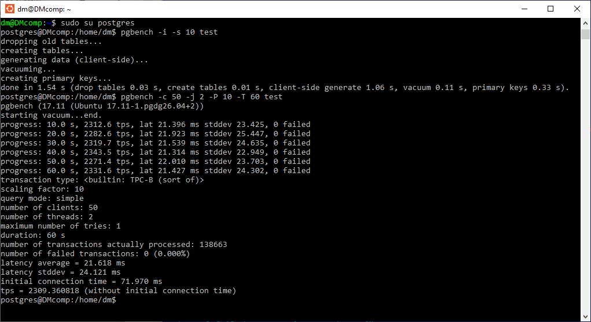
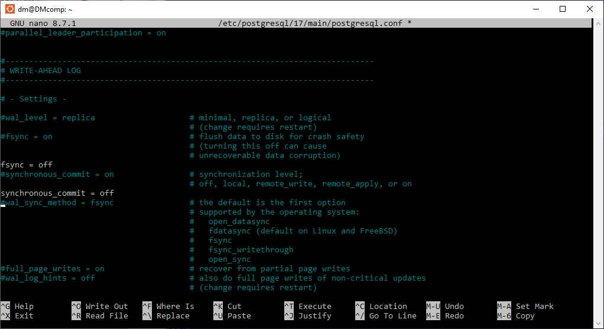
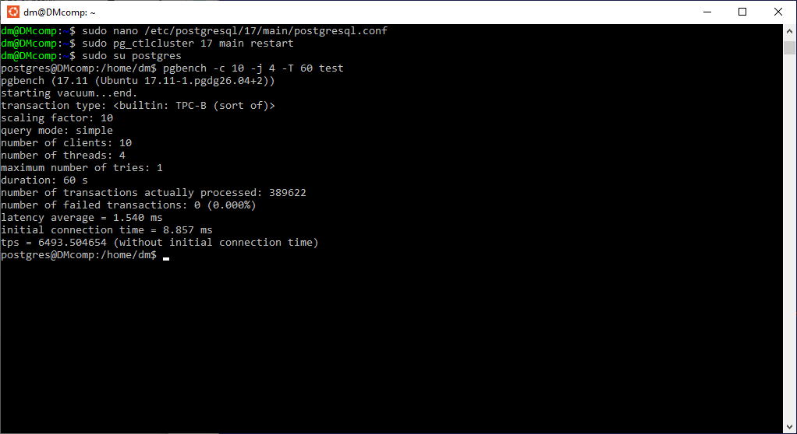

# Настройка PostgreSQL // ДЗ 4

## 1.Используйте существующую ВМ/стенд с PostgreSQL;
запустим ранее установленный WSL c Ubuntu 
sudo pg_ctlcluster 17 main restart

## 2.Подготовьте pgbench: инициализируйте тестовую базу (scale выбрать 10);
```sh
sudo su postgres
pgbench -i -s 10 test
```

## 3.Выполните baseline-прогон pgbench с фиксированными настройками (например, 60 секунд, 10 клиентов, 4 потока);
```sh
pgbench -c 10 -j 4 -T 60 test
```



## 4.Зафиксируйте tps baseline и условия теста (scale, время, клиенты/потоки);
| scale	| 10 |
| длительность | 60 с |
| клиенты / потоки | 10 / 4 |
| tps | 2309.360818 |

## 5.Измените параметры PostgreSQL для получения максимальной производительности

исправим параметры настроек postgresql.conf
fsync = off
synchronous_commit = off 

```sh
sudo nano /etc/postgresql/17/main/postgresql.conf
```


## 6.Перезапустите кластер (если требуется) и повторите pgbench с теми же настройками;

```sh
pg_lsclusters
sudo pg_ctlcluster 17 main restart
sudo su postgres
pgbench -c 10 -j 4 -T 60 test
```


попробуем разные варианты с данными параметрами
```sh
3.
fsync = on
synchronous_commit = off 
tps = 6370.695328
```

```sh
4.
fsync = off
synchronous_commit = on
tps = 6404.805514
```sh

## 7.Сравните tps до/после и сделайте вывод, какие изменения дали эффект;
Включение обоих параметров, дает приблизительный прирост на 280%,
поочередное включение имеет плюс минус такой же эффект.


## 8.Кратко обоснуйте изменение каких параметров больше всего влияет на повышение производительности;
Когда fsync отключен, PostgreSQL больше не принудительно сбрасывает данные на физический диск, позволяя операционной системе свободно буферизовать и откладывать запись.
Риски использования: возможна необратимая несогласованность данных, повреждение индексов. 

Когда synchronous_commit отключен, PostgreSQL не ждёт завершения записи WAL на диск перед возвратом клиенту сообщения «COMMIT успешен». Однако порядок записи WAL и файлов данных по-прежнему контролируется механизмом fsync.
Риски использования: база данных остаётся согласованной, теряются только ещё не записанные на диск коммиты.

Изменение данных параметров — это компромисс между скоростью и надёжностью. В некоторых случаях поступиться надёжностью недопустимо, например для баз данных банковских систем. Как вариант, экстренное повышение быстродействия можно проводить на тестовых базах, но недопустимо на проде.
