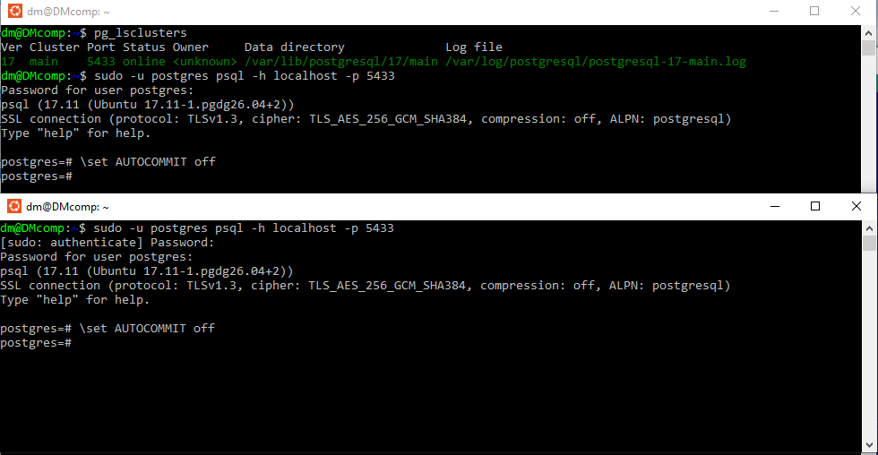
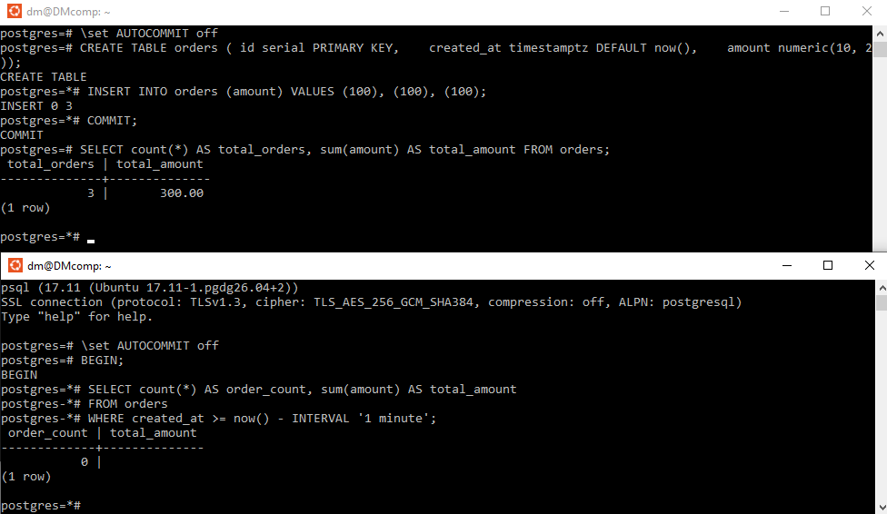
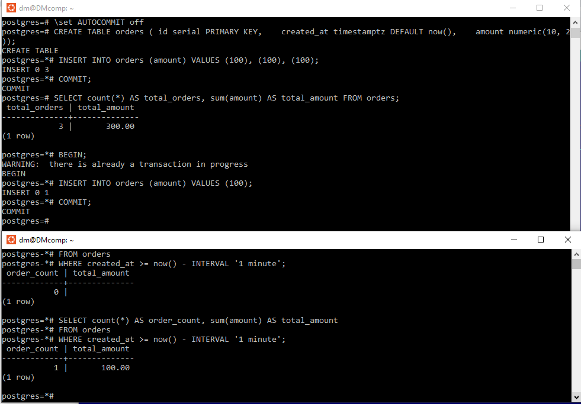
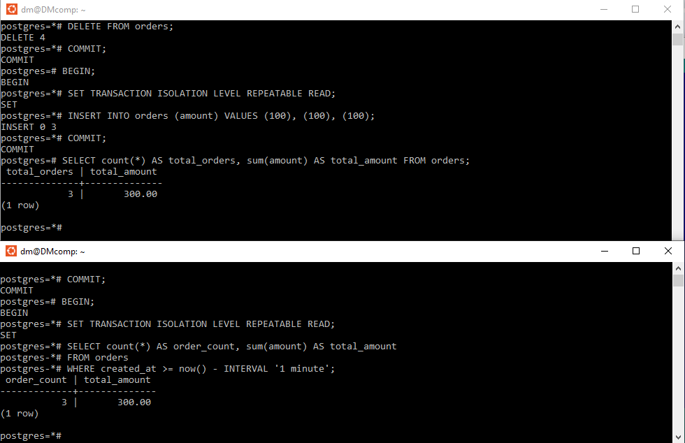

## Изоляция транзакций // ДЗ 5

# 1 Откройте 2 сессии psql к PostgreSQL 17 и отключите autocommit;

откроем окно с Ubunt, перезапсутим базу
```sh
sudo pg_ctlcluster 17 main restart
pg_lsclusters
```

откроем второй теримнал, в каждом из терминалов подключимся к базе
и отключим autocommit, что бы зафиксировать эффект от параллельных транзакций

```sh
sudo -u postgres psql -h localhost -p 5433
\set AUTOCOMMIT off
```



# 2 Создайте таблицу orders(id serial, created_at timestamptz, amount numeric) и вставьте 2–3 записи;

подготовим записи для тестов
```sql
CREATE TABLE orders ( id serial PRIMARY KEY,    created_at timestamptz DEFAULT now(),    amount numeric(10, 2));
INSERT INTO orders (amount) VALUES (100), (100), (100);
COMMIT;
SELECT count(*) AS total_orders, sum(amount) AS total_amount FROM orders;
```

# 3 Read committed: в сессии 2 начните транзакцию и выполните select count(*), sum(amount) ... за последнюю минуту;  в сессии 1 вставьте новый заказ и выполните commit;  в сессии 2 повторите тот же select и зафиксируйте изменение; завершите транзакции;

```sql
-- Сессия 2
BEGIN; -- Уровень изоляции по умолчанию — Read Committed
SELECT count(*) AS order_count, sum(amount) AS total_amount
FROM orders
WHERE created_at >= now() - INTERVAL '1 minute';
```



Так как запрос "... за последнюю минуту" вносит элемент непредсказуемости если возникла задержка с вводом команд в сессии 2,
предлагаю от данного условия отказаться. так же исключим подсчет значений и сумм в пользу простой выборки,
так как список значений у нас минимален и предсказуем.

Повторим эксперимент 

```sql
-- Сессия 1 (вернем таблицу в исходное состояние базовых 3х записей)
BEGIN;
DELETE FROM orders;
COMMIT;
INSERT INTO orders (amount) VALUES (100), (100), (100);
COMMIT;
show transaction isolation level;
SELECT * FROM orders;

-- Сессия 2 (проверим исходную таблицу из второй сессии)
show transaction isolation level;
SELECT * FROM orders;

-- Сессия 1 (внесем запись в таблицу)
BEGIN;
INSERT INTO orders (amount) VALUES (100);
COMMIT;
SELECT * FROM orders;

-- Сессия 2 
SELECT * FROM orders;
```



в READ COMMITTED каждый отдельный оператор видит только зафиксированные данные на момент его выполнения. 

# 4 Repeatable read: повторите сценарий, но обе транзакции начните с set transaction isolation level repeatable read; сравните результаты внутри транзакции и после её завершения;

повторим эксперимент с изоляцией Repeatable read

```sql
-- Сессия 1 (вернем таблицу в исходное состояние базовых 3х записей)
DELETE FROM orders;
COMMIT;
INSERT INTO orders (amount) VALUES (100), (100), (100);
COMMIT;
BEGIN;
SET TRANSACTION ISOLATION LEVEL REPEATABLE READ; 
show transaction isolation level;
SELECT * FROM orders;

-- Сессия 2 (проверим исходную таблицу из второй сессии)
BEGIN;
SET TRANSACTION ISOLATION LEVEL REPEATABLE READ; 
show transaction isolation level;
SELECT * FROM orders;

-- Сессия 1 (внесем запись в таблицу)
INSERT INTO orders (amount) VALUES (100);
COMMIT;
SELECT * FROM orders;

-- Сессия 2 
SELECT * FROM orders;
```


Запись от Сессии 1 не видна в Сессии 2.
REPEATABLE READ гарантирует, что все запросы в одной транзакции видят один и тот же снимок данных (snapshot) на момент первого читающего запроса в транзакции. Новые зафиксированные изменения от других транзакций не видны до завершения текущей.

# 5 В отчёте укажите, где и почему меняются значения, и какой уровень изоляции нужен для отчёта;
Для отчёта, где несколько запросов должны быть согласованы между собой, нужен Repeatable Read. Для обычной OLTP-нагрузки чаще достаточно Read Committed.

