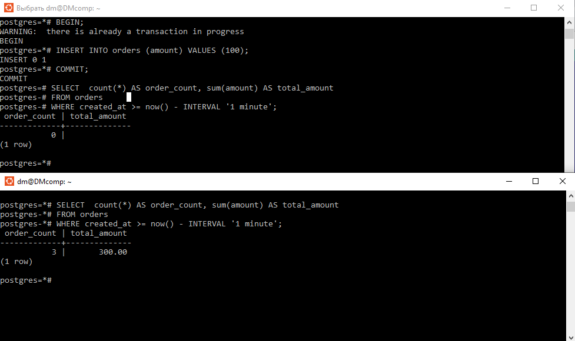

## Изоляция транзакций // ДЗ 5

# 1 Откройте 2 сессии psql к PostgreSQL 17 и отключите autocommit;

откроем окно с Ubunt, перезапсутим базу
```sh
sudo pg_ctlcluster 17 main restart
pg_lsclusters
```

откроем второй теримнал, в каждом из терминалов подключимся к базе
и отключим autocommit

```sh
sudo -u postgres psql -h localhost -p 5433
\set AUTOCOMMIT off
```


# 2 Создайте таблицу orders(id serial, created_at timestamptz, amount numeric) и вставьте 2–3 записи;

```sql
CREATE TABLE orders ( id serial PRIMARY KEY,    created_at timestamptz DEFAULT now(),    amount numeric(10, 2));
INSERT INTO orders (amount) VALUES (100), (100), (100);
COMMIT;
SELECT count(*) AS total_orders, sum(amount) AS total_amount FROM orders;
```

# 3 Read committed: в сессии 2 начните транзакцию и выполните select count(*), sum(amount) ... за последнюю минуту;  в сессии 1 вставьте новый заказ и выполните commit;  в сессии 2 повторите тот же select и зафиксируйте изменение; завершите транзакции;

```sql
-- Сессия 2
BEGIN; -- Уровень изоляции по умолчанию — Read Committed
SELECT count(*) AS order_count, sum(amount) AS total_amount
FROM orders
WHERE created_at >= now() - INTERVAL '1 minute';
```


```sql
-- Сессия 1
BEGIN;
INSERT INTO orders (amount) VALUES (100);
COMMIT;

-- Сессия 2 (та же транзакция)
SELECT count(*) AS order_count, sum(amount) AS total_amount
FROM orders
WHERE created_at >= now() - INTERVAL '1 minute';

-- Сессия 2
COMMIT;
```


# 4 Repeatable read: повторите сценарий, но обе транзакции начните с set transaction isolation level repeatable read; сравните результаты внутри транзакции и после её завершения;

подготвоим таблицу к новым сценариям, удалим заначения 
повторим эксперимент с Repeatable read

```sql
(0)
-- Сессия 1 (или любая другая)
DELETE FROM orders;
COMMIT;

(1)
-- Сессия 1
BEGIN;
SET TRANSACTION ISOLATION LEVEL REPEATABLE READ; 
INSERT INTO orders (amount) VALUES (100), (100), (100);
COMMIT;
SELECT count(*) AS total_orders, sum(amount) AS total_amount FROM orders;

(2)
-- Сессия 2
BEGIN;
SET TRANSACTION ISOLATION LEVEL REPEATABLE READ;
SELECT count(*) AS order_count, sum(amount) AS total_amount
FROM orders
WHERE created_at >= now() - INTERVAL '1 minute';
```


```sql
(3)
-- Сессия 1
BEGIN;
INSERT INTO orders (amount) VALUES (100);
COMMIT;

(4)
-- Сессия 2 (та же транзакция)
SELECT  count(*) AS order_count, sum(amount) AS total_amount
FROM orders
WHERE created_at >= now() - INTERVAL '1 minute';
```



# 5 В отчёте укажите, где и почему меняются значения, и какой уровень изоляции нужен для отчёта;

