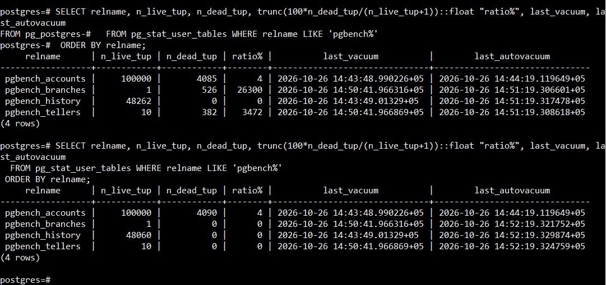
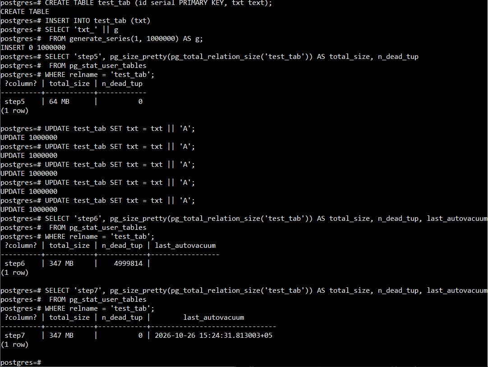
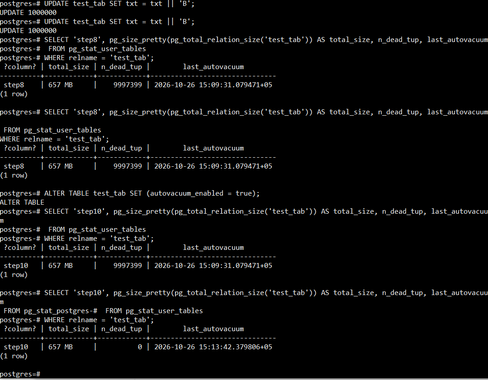

# MVCC, vacuum и autovacuum // ДЗ 6

## 1.Создайте ВМ (2 vCPU, 4 GB RAM, SSD 10 GB) и установите PostgreSQL 17 с дефолтными настройками;

```sh
sudo pg_ctlcluster 17 main restart
pg_lsclusters
sudo -u postgres psql -h localhost -p 5433
```

## 2. Подготовьте тестовую базу pgbench (pgbench -i postgres) и выполните прогон нагрузки (pgbench -c8 -P 6 -T 60 -U postgres postgres);

```sh
pgbench -i postgres
pgbench -c8 -P 6 -T 60 -U postgres postgres
```

## 3.Зафиксируйте состояние обслуживания после нагрузки: для пользовательских таблиц сохраните n_dead_tup, last_autovacuum, last_vacuum из pg_stat_user_tables;

```sql
SELECT relname, n_live_tup, n_dead_tup, trunc(100*n_dead_tup/(n_live_tup+1))::float "ratio%", last_vacuum, last_autovacuum
  FROM pg_stat_user_tables WHERE relname LIKE 'pgbench%'
 ORDER BY relname;
```

зафиксировали состояние до и после срабатывания автовакума

## 4.Создайте таблицу с текстовым полем и заполните её 1 000 000 строк (допускается генерация через generate_series);

```sql
CREATE TABLE test_tab (id serial PRIMARY KEY, txt text);

INSERT INTO test_tab (txt)
SELECT 'txt_' || g
 FROM generate_series(1, 1000000) AS g;
```

## 5.Зафиксируйте размер таблицы (например, pg_total_relation_size) и значение n_dead_tup;

```sql
SELECT 'step5', pg_size_pretty(pg_total_relation_size('test_tab')) AS total_size, n_dead_tup
 FROM pg_stat_user_tables
WHERE relname = 'test_tab';
```
размер = 64 Mb, n_dead_tup = 0

## 6.Выполните 5 полных обновлений строк (добавление символа к текстовому полю), затем зафиксируйте n_dead_tup, last_autovacuum и размер таблицы;

```sql
UPDATE test_tab SET txt = txt || 'A'; -- 5 раз

SELECT 'step6', pg_size_pretty(pg_total_relation_size('test_tab')) AS total_size, n_dead_tup, last_autovacuum
 FROM pg_stat_user_tables
WHERE relname = 'test_tab';
```
размер = 347 Mb, n_dead_tup = 4999814

## 7.Дождитесь срабатывания autovacuum (периодически проверяя last_autovacuum) и зафиксируйте изменения n_dead_tup/размера;

```sql
SELECT 'step7', pg_size_pretty(pg_total_relation_size('test_tab')) AS total_size, n_dead_tup, last_autovacuum
 FROM pg_stat_user_tables
WHERE relname = 'test_tab';
```
размер = 347 Mb, n_dead_tup = 0
размер таблицы после отработки autovacuum не изменился, но счетчик мертвых строк обнулился



## 8.Отключите autovacuum только для этой таблицы, выполните 10 полных обновлений строк и снова зафиксируйте n_dead_tup и размер;

```sql
ALTER TABLE test_tab SET (autovacuum_enabled = false);

UPDATE test_tab SET txt = txt || 'B';  -- 10 раз

SELECT 'step8', pg_size_pretty(pg_total_relation_size('test_tab')) AS total_size, n_dead_tup, last_autovacuum
 FROM pg_stat_user_tables
WHERE relname = 'test_tab';
```
размер = 657 Mb, n_dead_tup = 9997399

## 9.Объясните наблюдения: почему растёт размер и/или число «мёртвых» строк при отключённом обслуживании;
UPDATE не изменяет исходную строку, а вставляет новую версию строки и помечает старую версию как мёртвую.
при отключенном autovacuum количество мертвых строк накапливается, что приводит к раздуванию таблицы и 
к снижению производительности, из-за излишнего сканирования индексов мертвых строк. 
включение autovacuum не уменьшит размеры таблицы, но вернет прежную производительность.
для уменьшения размеров таблицы потребуется VACUUM FULL. но для подобных работ на PROD нужно предусматривать 
технологическое окно, так как операция приведет к блокировке таблицы.


## 10.Включите autovacuum обратно для таблицы;


``` sql
ALTER TABLE test_tab SET (autovacuum_enabled = true);

SELECT 'step10', pg_size_pretty(pg_total_relation_size('test_tab')) AS total_size, n_dead_tup, last_autovacuum
 FROM pg_stat_user_tables
WHERE relname = 'test_tab';
```
размер = 657 Mb, n_dead_tup = 0


дополнительно проведем эксперимент по уменьшению размеров таблицы через операцию VACUUM FULL 

``` sql
VACUUM FULL test_tab;

SELECT 'step10.2', pg_size_pretty(pg_total_relation_size('test_tab')) AS total_size, n_dead_tup, last_autovacuum
 FROM pg_stat_user_tables
WHERE relname = 'test_tab';
``` 
размер = 71 Mb, n_dead_tup = 0
