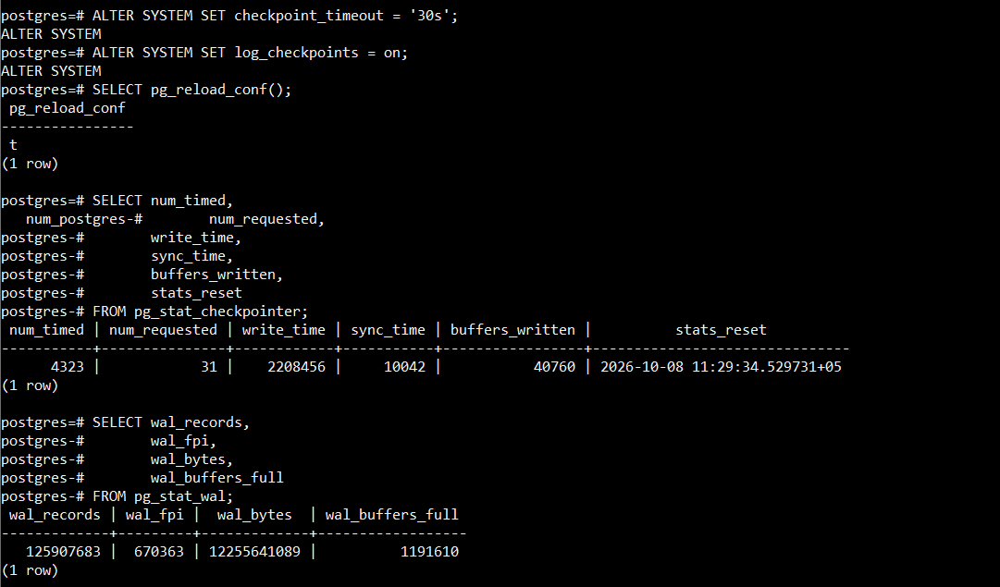
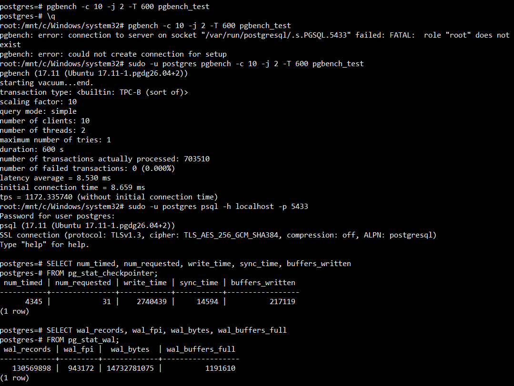
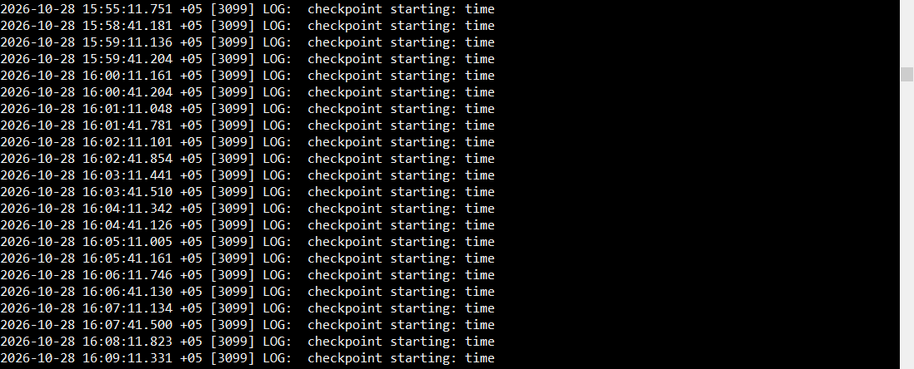

# Журналы // ДЗ 7

## 1. Используйте стенд с PostgreSQL 17 (допускается ВМ из предыдущих ДЗ) и установите pgbench;

```sh
sudo pg_ctlcluster 17 main restart
pg_lsclusters
sudo -u postgres psql -h localhost -p 5433
```

Создадим тестовую БД 
```sql
create database pgbench_test;
```

И инициализируем схему pgbench, как это выполнялось в hw04
```sh
sudo -u postgres pgbench -i -s 10 pgbench_test;
```

## 2. Настройте выполнение контрольной точки раз в 30 секунд (параметр времени) и включите логирование контрольных точек;

```sql
ALTER SYSTEM SET checkpoint_timeout = '30s';
ALTER SYSTEM SET log_checkpoints = on;
SELECT pg_reload_conf(); -- применим изменения конфигурации
```

Проверим, что параметры применились
```sh
sudo -u postgres psql -c "SHOW checkpoint_timeout;"
sudo -u postgres psql -c "SHOW log_checkpoints;"
```

## 3. Зафиксируйте начальные значения статистики контрольных точек и WAL (снимок «до»);

Соберем статистику контрольных точек из представления pg_stat_checkpointer, WAL-статистику из pg_stat_wal.

```sql
-- Статистика контрольных точек 
SELECT num_timed,
       num_requested,
       write_time,
       sync_time,
       buffers_written,
       stats_reset
FROM pg_stat_checkpointer;

-- Статистика WAL 
SELECT wal_records,
       wal_fpi,
       wal_bytes,
       wal_buffers_full
FROM pg_stat_wal;
```

Запишите полученные значения — это будет снимок «до».
```sql
 num_timed | num_requested | write_time | sync_time | buffers_written |          stats_reset
-----------+---------------+------------+-----------+-----------------+-------------------------------
      4323 |            31 |    2208456 |     10042 |           40760 | 2026-10-08 11:29:34.529731+05

 wal_records | wal_fpi |  wal_bytes  | wal_buffers_full
-------------+---------+-------------+------------------
   125907683 |  670363 | 12255641089 |          1191610
```



## 4. Запустите нагрузку pgbench на 10 минут и зафиксируйте TPS;

Запустим нагрузку в 10 минут, на 10 клиентов в 2 потока
```bash
sudo -u postgres pgbench -c 10 -j 2 -T 600 pgbench_test
```

```
pgbench (17.11 (Ubuntu 17.11-1.pgdg26.04+2))
starting vacuum...end.
transaction type: <builtin: TPC-B (sort of)>
scaling factor: 10
query mode: simple
number of clients: 10
number of threads: 2
maximum number of tries: 1
duration: 600 s
number of transactions actually processed: 703510
number of failed transactions: 0 (0.000%)
latency average = 8.530 ms
initial connection time = 8.659 ms
tps = 1172.335740 (without initial connection time)
```

tps = 1172.335740 (without initial connection time)

## 5. Зафиксируйте конечные значения статистики контрольных точек и WAL (снимок «после»);

Снимим статистику контрольных точек после
```sql
SELECT num_timed, num_requested, write_time, sync_time, buffers_written
FROM pg_stat_checkpointer;

SELECT wal_records, wal_fpi, wal_bytes, wal_buffers_full
FROM pg_stat_wal;
```

```sql
 num_timed | num_requested | write_time | sync_time | buffers_written
-----------+---------------+------------+-----------+-----------------
      4345 |            31 |    2740439 |     14594 |          217119

 wal_records | wal_fpi |  wal_bytes  | wal_buffers_full
-------------+---------+-------------+------------------
   130569898 |  943172 | 14732781075 |          1191610
```



## 6. Рассчитайте объём WAL за 10 минут и средний объём WAL на одну контрольную точку;

Объём WAL за интервал нагрузки вычисляется как разница значений wal_bytes между снимками «после» и «до»:

объём WAL за 10 минут
A = wal_bytes_after - wal_bytes_before =  14732781075 - 12255641089 = 2477139986

Количество контрольных точек
B = num_timed_after + num_requested_after - (num_timed_before + num_requested_before) = 4345 + 31 - ( 4323 + 31 ) = 22

Средний объём WAL на одну контрольную точку
A / B = 2477139986 / 22 = 112597272.09

## 7. Проверьте по статистике/логам, выполнялись ли контрольные точки строго по расписанию, и объясните отклонения;

проверим логи на наличее "checkpoint starting"

```bash
sudo grep -i "checkpoint starting" /var/log/postgresql/postgresql-17-main.log
```



Так как за 10 минут в логах фиксируются "checkpoint starting: time" (запуск по расписанию checkpoint_timeout) и 
отсутсвуют "checkpoint starting: wal" (запуск из-за заполнения WAL-сегментов) 
констатируем что контрольные точки шли строго по расписанию.
и их количество около 20 штук, что совпадает с расчетными значениями выше.

## 8. Сравните TPS при синхронном и асинхронном подтверждении коммита (2 прогона pgbench в сопоставимых условиях) и объясните разницу;

Первый прогон был проведен в синхронном режиме, со значением synchronous_commit = on, по умолчанию.
получено tps = 1172

Выполним второй прогон в асинхронном режиме
```sql
ALTER SYSTEM SET synchronous_commit = off;
SELECT pg_reload_conf();
```

Подадим туже нагрузку
```bash
pgbench -c 10 -j 2 -T 600 pgbench_test
```

tps = 12103.305063 (without initial connection time)

Разница первого и второго прогона в tps на порядок.
Объесние кроется в том что в синхронном режиме база не возвращает управление клиенту после каждого коммита, пока WAL-запись не будет синхронизирована с диском (fsync).
В асинхронном режиме подтверждение коммита происходит без ожидания fsync WAL, это резко увеличивает TPS.
Но при этом растет риск потери последних коммитов при аварийном завершении. 
