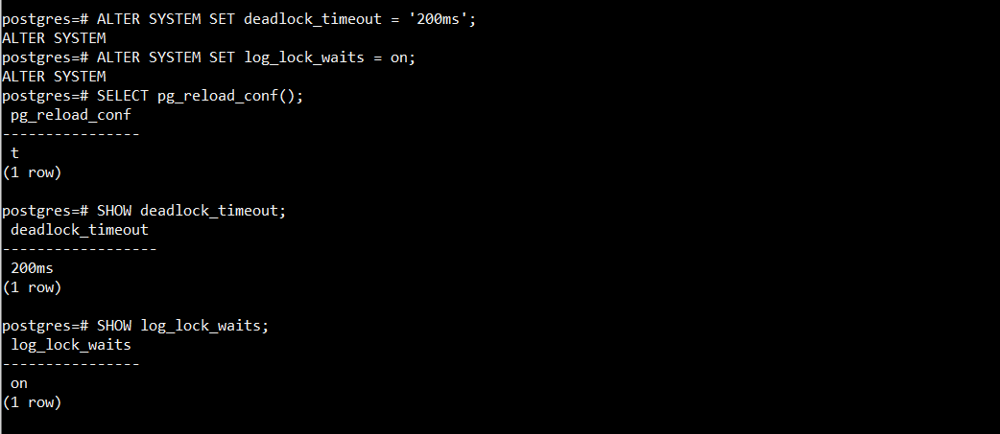
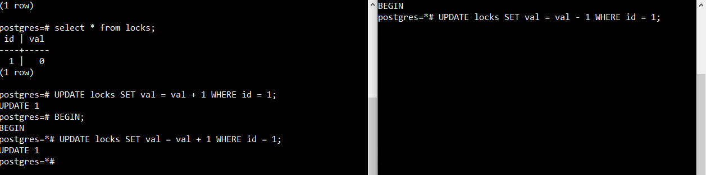
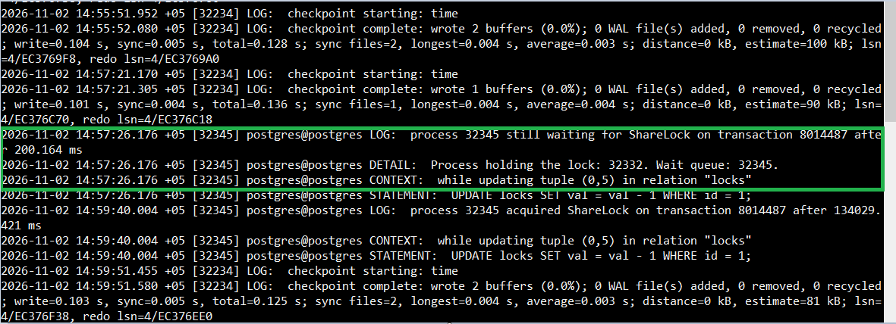
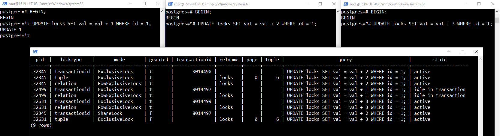
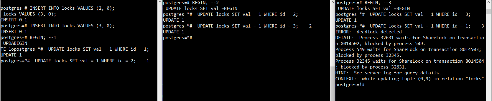
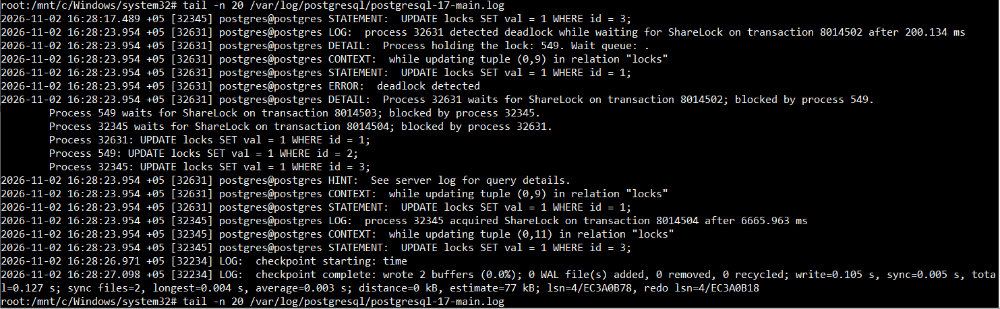
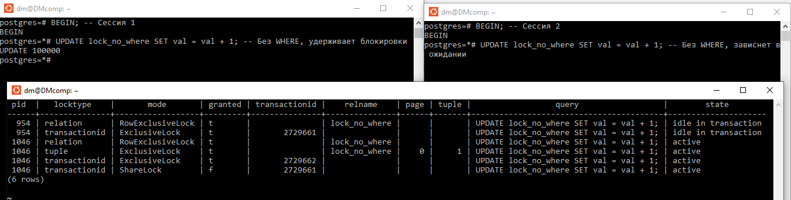

# Блокировки // ДЗ 8

## 1. Настройте PostgreSQL так, чтобы в журнал сообщений записывались ожидания блокировок дольше 200 мс;

```sh
sudo pg_ctlcluster 17 main restart
pg_lsclusters
sudo -u postgres psql -h localhost -p 5433
```

```sql
ALTER SYSTEM SET deadlock_timeout = '200ms'; --  дольше 200 мс 
ALTER SYSTEM SET log_lock_waits = on; -- ожидание блокировки вкл
SELECT pg_reload_conf();

SHOW deadlock_timeout;  -- проверим
SHOW log_lock_waits;
```


## 2. Воспроизведите ожидание блокировки дольше 200 мс и подтвердите это записью в журнале сообщений;

```sql 
BEGIN;-- сессия 1
CREATE TABLE locks (id int PRIMARY KEY, val int);
INSERT INTO locks VALUES (1, 0);
UPDATE locks SET val = val + 1 WHERE id = 1;
-- не завершаем транзакцию и открываем вторую сессию
BEGIN;-- сессия 2
UPDATE locks SET val = val - 1 WHERE id = 1;
```


вторая сессия зависает. ждем несколько секунд и завершаем первую сессию
```Sql
-- сессия 1
ROLLBACK;
-- сессия 2 выходит из блокировки
```


проверим записи в журнале 
```sh
tail -n 20 /var/log/postgresql/postgresql-17-main.log
```


и видим запись о блокировке
       	
## 3. Откройте три сессии psql к одной базе данных;
## 4. Создайте тестовую таблицу и добавьте одну строку, которую будут обновлять все сессии;

```sql -- 1
DROP TABLE locks;
CREATE TABLE locks (id int PRIMARY KEY, val int);
INSERT INTO locks VALUES (1, 0);
```

## 5. Выполните в трёх сессиях команды UPDATE, обновляющие одну и ту же строку, так чтобы одна транзакция удерживала блокировку, а остальные ожидали;

```sql
BEGIN; -- 1
UPDATE locks SET val = val + 1 WHERE id = 1;

BEGIN; -- 2 
UPDATE locks SET val = val + 1 WHERE id = 1;
-- сессия 2 ожидает

BEGIN; -- 3 
UPDATE locks SET val = val + 1 WHERE id = 1;
-- сессия 3 ожидает
```

## 6. Во время ожидания снимите список блокировок из представления pg_locks и сохраните его для отчёта;


```Sql -- 4 сессия
SELECT
    l.pid,
    l.locktype,
    l.mode,
    l.granted,
    l.transactionid,
    l.relation::regclass AS relname,
    l.page,
    l.tuple,
    a.query,
    a.state
FROM pg_locks l
LEFT JOIN pg_stat_activity a ON a.pid = l.pid
WHERE l.relation = 'locks'::regclass
   OR l.transactionid IS NOT NULL
ORDER BY l.granted DESC, l.pid;
```


получаем результат вида
```sql
  pid  |   locktype    |       mode       | granted | transactionid | relname | page | tuple |                    query                     |        state
-------+---------------+------------------+---------+---------------+---------+------+-------+----------------------------------------------+---------------------
 32345 | transactionid | ExclusiveLock    | t       |       8014498 |         |      |       | UPDATE locks SET val = val + 2 WHERE id = 1; | active
 32345 | tuple         | ExclusiveLock    | t       |               | locks   |    0 |     6 | UPDATE locks SET val = val + 2 WHERE id = 1; | active
 32345 | relation      | RowExclusiveLock | t       |               | locks   |      |       | UPDATE locks SET val = val + 2 WHERE id = 1; | active
 32499 | transactionid | ExclusiveLock    | t       |       8014497 |         |      |       | UPDATE locks SET val = val + 1 WHERE id = 1; | idle in transaction
 32499 | relation      | RowExclusiveLock | t       |               | locks   |      |       | UPDATE locks SET val = val + 1 WHERE id = 1; | idle in transaction
 32631 | transactionid | ExclusiveLock    | t       |       8014499 |         |      |       | UPDATE locks SET val = val + 3 WHERE id = 1; | active
 32631 | relation      | RowExclusiveLock | t       |               | locks   |      |       | UPDATE locks SET val = val + 3 WHERE id = 1; | active
 32345 | transactionid | ShareLock        | f       |       8014497 |         |      |       | UPDATE locks SET val = val + 2 WHERE id = 1; | active
 32631 | tuple         | ExclusiveLock    | f       |               | locks   |    0 |     6 | UPDATE locks SET val = val + 3 WHERE id = 1; | active
(9 rows)
```

## 7. Объясните смысл каждой блокировки из pg_locks (что блокируется, какой режим, кто держит, кто ожидает);

В pg_locks каждая строка описывает блокировку, запрошенную или удерживаемую процессом из колонки pid, 
где granted = t означает, что блокировка получена, 
а granted = f - что процесс её ожидает. 

Держателями являются:
1) 32499 (удерживает ExclusiveLock на свой XID 8014497 и RowExclusiveLock на таблицу locks), 
2) 32345 (удерживает ExclusiveLock на свой XID 8014498, tuple-блокировку (0,6) и RowExclusiveLock на таблицу)  
         ожидает ShareLock на XID 8014497, то есть завершения транзакции 32499.  
3) 32631 (удерживает ExclusiveLock на свой XID 8014499 и RowExclusiveLock на таблицу), 
         ожидает tuple-блокировку (0,6), удерживаемую 32345.

Таким образом, образуется линейная очередь 32499 > 32345 > 32631 
без цикла, поэтому это обычное ожидание блокировки, а не взаимоблокировка.

## 8. Воспроизведите взаимоблокировку трех транзакций. Можно ли разобраться в ситуации постфактум, изучая журнал сообщений?

в трёх разных сессиях
```sql
INSERT INTO locks VALUES (2, 0);
INSERT INTO locks VALUES (3, 0);
BEGIN; --1
 UPDATE locks SET val = 1 WHERE id = 1;

BEGIN; --2
 UPDATE locks SET val = 1 WHERE id = 2;

BEGIN; --3
 UPDATE locks SET val = 1 WHERE id = 3;

 UPDATE locks SET val = 1 WHERE id = 2; -- 1

 UPDATE locks SET val = 1 WHERE id = 3; -- 2

 UPDATE locks SET val = 1 WHERE id = 1; -- 3

--ловим уведомление в сессии 3, которое говорит что deadlock принудительно разомкнут
ERROR:  deadlock detected
DETAIL:  Process 32631 waits for ShareLock on transaction 8014502; blocked by process 549.
Process 549 waits for ShareLock on transaction 8014503; blocked by process 32345.
Process 32345 waits for ShareLock on transaction 8014504; blocked by process 32631.
HINT:  See server log for query details.
CONTEXT:  while updating tuple (0,9) in relation "locks"
postgres=!#
```



проверим логи
```sh
tail -n 20 /var/log/postgresql/postgresql-17-main.log
```


```sh
2026-11-02 16:28:17.489 +05 [32345] postgres@postgres STATEMENT:  UPDATE locks SET val = 1 WHERE id = 3;
2026-11-02 16:28:23.954 +05 [32631] postgres@postgres LOG:  process 32631 detected deadlock while waiting for ShareLock on transaction 8014502 after 200.134 ms
2026-11-02 16:28:23.954 +05 [32631] postgres@postgres DETAIL:  Process holding the lock: 549. Wait queue: .
2026-11-02 16:28:23.954 +05 [32631] postgres@postgres CONTEXT:  while updating tuple (0,9) in relation "locks"
2026-11-02 16:28:23.954 +05 [32631] postgres@postgres STATEMENT:  UPDATE locks SET val = 1 WHERE id = 1;
2026-11-02 16:28:23.954 +05 [32631] postgres@postgres ERROR:  deadlock detected
2026-11-02 16:28:23.954 +05 [32631] postgres@postgres DETAIL:  Process 32631 waits for ShareLock on transaction 8014502; blocked by process 549.
        Process 549 waits for ShareLock on transaction 8014503; blocked by process 32345.
        Process 32345 waits for ShareLock on transaction 8014504; blocked by process 32631.
        Process 32631: UPDATE locks SET val = 1 WHERE id = 1;
        Process 549: UPDATE locks SET val = 1 WHERE id = 2;
        Process 32345: UPDATE locks SET val = 1 WHERE id = 3;
2026-11-02 16:28:23.954 +05 [32631] postgres@postgres HINT:  See server log for query details.
2026-11-02 16:28:23.954 +05 [32631] postgres@postgres CONTEXT:  while updating tuple (0,9) in relation "locks"
2026-11-02 16:28:23.954 +05 [32631] postgres@postgres STATEMENT:  UPDATE locks SET val = 1 WHERE id = 1;
2026-11-02 16:28:23.954 +05 [32345] postgres@postgres LOG:  process 32345 acquired ShareLock on transaction 8014504 after 6665.963 ms
2026-11-02 16:28:23.954 +05 [32345] postgres@postgres CONTEXT:  while updating tuple (0,11) in relation "locks"
2026-11-02 16:28:23.954 +05 [32345] postgres@postgres STATEMENT:  UPDATE locks SET val = 1 WHERE id = 3;
2026-11-02 16:28:26.971 +05 [32234] LOG:  checkpoint starting: time
2026-11-02 16:28:27.098 +05 [32234] LOG:  checkpoint complete: wrote 2 buffers (0.0%); 0 WAL file(s) added, 0 removed, 0 recycled; write=0.105 s, sync=0.005 s, total=0.127 s; sync files=2, longest=0.004 s, average=0.003 s; distance=0 kB, estimate=77 kB; lsn=4/EC3A0B78, redo lsn=4/EC3A0B18
```

постфактум разобраться можно, особенно если включены log_lock_waits и логирование запросов; 
событие deadlock detected фиксируется в логах, отталикиваясь от этого события можно раскрутить всю цепочку событий.

## 9. Могут ли две транзакции, выполняющие единственную команду UPDATE одной и той же таблицы (без where), заблокировать друг друга?

Две транзакции с UPDATE без WHERE создают длительное ожидание, но не взаимоблокировку, так как PostgreSQL обрабатывает строки в фиксированном физическом порядке.

## Задание со звёздочкой. Попробуйте воспроизвести ситуацию из пункта 9.
```sql
-- Подготовка таблицы с несколькими строками
CREATE TABLE lock_no_where (id int PRIMARY KEY, val int);
INSERT INTO lock_no_where SELECT generate_series(1, 100000), 0;

BEGIN; -- Сессия 1
UPDATE lock_no_where SET val = val + 1; -- Без WHERE, удерживает блокировки
--не завершаем транзакцию

BEGIN; -- Сессия 2
UPDATE lock_no_where SET val = val + 1; -- Без WHERE, зависнет в ожидании
```

в Сессии 3 проверим pg_locks как в пункте 6.



pid 954 — idle in transaction: выполнила BEGIN; UPDATE lock_no_where SET val = val + 1; (без WHERE) и не завершила транзакцию. Это держатель.
pid 1046 — active: выполняет такой же UPDATE без WHERE и ждёт завершения 954.

В спискее видна линейная зависимость 954 > 1046: 954 держит XID 2729661 и таблицу, 1046 держит свой XID, таблицу и tuple-блокировку (0,1), но ожидает ShareLock на XID 2729661. 
Ошибки deadlock detected не будет — PostgreSQL не обнаружит цикл в графе ожиданий. Это длительное ожидание блокировки, а не взаимоблокировка, что и требовалось показать.

