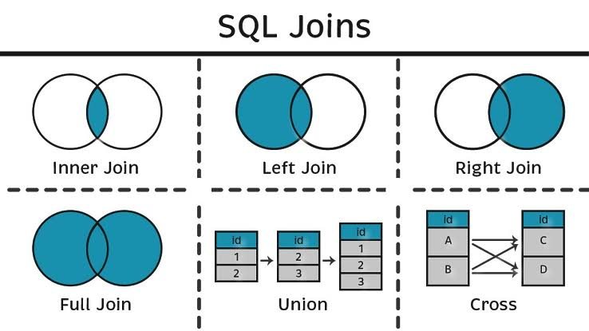

# Выборка данных, виды join'ов. // ДЗ 9

Необходимо:
1. Реализовать прямое соединение двух или более таблиц
2. Реализовать левостороннее (или правостороннее) соединение двух или более таблиц
3. Реализовать кросс соединение двух или более таблиц
4. Реализовать полное соединение двух или более таблиц
5. Реализовать запрос, в котором будут использованы разные типы соединений
6. Сделать комментарии на каждый запрос
7. К работе приложить структуру таблиц, для которых выполнялись соединения

Для работы используем знакомую мне банковскую тематику.
Создадим 4 таблицы: UL_CLI (клиенты), AGR (договоры), ACC (счета), PAY (платежи).
Для каждой таблицы зададим явный PRIMARY KEY.

```sql
-- Клиенты банка
CREATE TABLE UL_CLI (
    CLIENT_ID    SERIAL       PRIMARY KEY,
    FULL_NAME    VARCHAR(120) NOT NULL,
    INN          VARCHAR(12),
    CITY         VARCHAR(60)
);

-- Договоры (РКО, кредит, депозит, ...)
CREATE TABLE AGR (
    AGR_ID        SERIAL      PRIMARY KEY,
    CLIENT_ID     INT         REFERENCES UL_CLI(CLIENT_ID),
    AGR_NO        VARCHAR(30) NOT NULL UNIQUE,
    AGR_TYPE      VARCHAR(30) NOT NULL,
    OPEN_DATE     DATE        NOT NULL,
    CLOSE_DATE    DATE
);

-- Счета
CREATE TABLE ACC (
    ACC_ID        SERIAL        PRIMARY KEY,
    AGR_ID        INT           NOT NULL REFERENCES AGR(AGR_ID),
    ACC_NO        VARCHAR(20)   NOT NULL UNIQUE,
    CURRENCY      CHAR(3)       NOT NULL DEFAULT 'RUB',
    BALANCE       NUMERIC(15,2) NOT NULL DEFAULT 0,
    STATUS        VARCHAR(15)   NOT NULL DEFAULT 'active'
);

-- Платежи
CREATE TABLE PAY (
    PAY_ID        SERIAL        PRIMARY KEY,
    ACC_ID        INT           NOT NULL REFERENCES ACC(ACC_ID),
    AMOUNT        NUMERIC(15,2) NOT NULL,
    PURPOSE       VARCHAR(200),
    PAY_DATE      DATE          NOT NULL,
    STATUS        VARCHAR(15)   NOT NULL DEFAULT 'executed'
);
```

наполним таблицы:
```sql
INSERT INTO UL_CLI (FULL_NAME, INN, CITY) VALUES
    ('ООО Клиент 1', '7701111111', 'Москва'),
    ('ИП Клиент 2',  '7702222222', 'Челябинск'),
    ('АО Клиент 3',  '7703333333', 'Санкт-Петербург'),
    ('ООО Клиент 4', '7804444444', 'Екатеринбург');  -- клиент без договоров

INSERT INTO AGR (CLIENT_ID, AGR_NO, AGR_TYPE, OPEN_DATE, CLOSE_DATE) VALUES
    (1, 'РКО-2026-001', 'РКО',     '2026-11-02', NULL),
    (1, 'КР-2026-014',  'Кредит',  '2026-11-02', NULL),
    (2, 'РКО-2026-002', 'РКО',     '2026-11-02', NULL),
    (3, 'ДЕП-2026-007', 'Депозит', '2026-11-02', NULL),
    (3, 'РКО-2026-003', 'РКО',     '2026-11-02', '2026-11-09'), -- закрытый договор
    (NULL, 'РКО-2026-066', 'РКО',  '2026-11-02', NULL);  -- дефектный договор без клиента

INSERT INTO ACC (AGR_ID, ACC_NO, CURRENCY, BALANCE, STATUS) VALUES
    (1, '40702810100000000001', 'RUB', 1250000.00, 'active'),  -- орг   
    (2, '45208810100000000002', 'RUB',  500000.00, 'active'),  -- кред
    (3, '40702810100000000003', 'RUB',   35000.00, 'active'),  -- орг   
    (4, '42108810100000000004', 'RUB', 3000000.00, 'active'),  -- депо
    (5, '40702810100000000005', 'RUB',       0.00, 'closed');  -- орг счёт без платежей

INSERT INTO PAY (ACC_ID, AMOUNT, PURPOSE, PAY_DATE, STATUS) VALUES
    (1,  150000.00, 'Оплата по счёту 114',    '2026-11-02', 'executed'),
    (1,   45000.00, 'Налог за 3 кв.',         '2026-11-02', 'executed'),
    (2,  200000.00, 'Погашение кредита',      '2026-11-02', 'executed'),
    (3,   12000.00, 'Оплата услуг связи',     '2026-11-02', 'executed'),
    (4, 1000000.00, 'Перевод на депозит',     '2026-11-02', 'executed'),
    (1,   30000.00, 'Оплата аренды',          '2026-11-02', 'rejected');
```

Проверим наличее данных в таблицах

```sql
postgres=# select * from UL_CLI;
 client_id |  full_name   |    inn     |      city
-----------+--------------+------------+-----------------
         1 | ООО Клиент 1 | 7701111111 | Москва
         2 | ИП Клиент 2  | 7702222222 | Челябинск
         3 | АО Клиент 3  | 7703333333 | Санкт-Петербург
         4 | ООО Клиент 4 | 7804444444 | Екатеринбург
(4 rows)

postgres=# select * from AGR;
 agr_id | client_id |    agr_no    | agr_type | open_date  | close_date
--------+-----------+--------------+----------+------------+------------
      1 |         1 | РКО-2026-001 | РКО      | 2026-11-02 |
      2 |         1 | КР-2026-014  | Кредит   | 2026-11-02 |
      3 |         2 | РКО-2026-002 | РКО      | 2026-11-02 |
      4 |         3 | ДЕП-2026-007 | Депозит  | 2026-11-02 |
      5 |         3 | РКО-2026-003 | РКО      | 2026-11-02 | 2026-11-09
      6 |           | РКО-2026-066 | РКО      | 2026-11-02 |
(6 rows)

postgres=# select * from ACC;
 acc_id | agr_id |        acc_no        | currency |  balance   | status
--------+--------+----------------------+----------+------------+--------
      1 |      1 | 40702810100000000001 | RUB      | 1250000.00 | active
      2 |      2 | 45208810100000000002 | RUB      |  500000.00 | active
      3 |      3 | 40702810100000000003 | RUB      |   35000.00 | active
      4 |      4 | 42108810100000000004 | RUB      | 3000000.00 | active
      5 |      5 | 40702810100000000005 | RUB      |       0.00 | closed
(5 rows)

postgres=# select * from PAY;
 pay_id | acc_id |   amount   |       purpose       |  pay_date  |  status
--------+--------+------------+---------------------+------------+----------
      1 |      1 |  150000.00 | Оплата по счёту 114 | 2026-11-02 | executed
      2 |      1 |   45000.00 | Налог за 3 кв.      | 2026-11-02 | executed
      3 |      2 |  200000.00 | Погашение кредита   | 2026-11-02 | executed
      4 |      3 |   12000.00 | Оплата услуг связи  | 2026-11-02 | executed
      5 |      4 | 1000000.00 | Перевод на депозит  | 2026-11-02 | executed
      6 |      1 |   30000.00 | Оплата аренды       | 2026-11-02 | rejected
(6 rows)
```

Зафиксируем стурктуру и связи: 
```sh
UL_CLI (CLIENT_ID PK)
   │ 1
   │
   │ N
AGR (AGR_ID PK, CLIENT_ID FK → UL_CLI.CLIENT_ID)
   │ 1
   │
   │ N
ACC (ACC_ID PK, AGR_ID FK → AGR.AGR_ID)
   │ 1
   │
   │ N
PAY (PAY_ID PK, ACC_ID FK → ACC.ACC_ID)
```

Добавим памятку для наглядности



## 1. Реализовать прямое соединение двух или более таблиц

Цель: получить все успешные платежи PAY в связке со счетом ACC и договором AGR.
Соединим три таблицы через INNER JOIN.

```sql
SELECT
    p.PAY_ID,
    p.PAY_DATE,
    g.AGR_NO,
    g.AGR_TYPE,
    a.ACC_NO,
    p.AMOUNT,
    p.PURPOSE
FROM PAY p
INNER JOIN ACC a ON p.ACC_ID = a.ACC_ID
INNER JOIN AGR g ON a.AGR_ID = g.AGR_ID
WHERE p.STATUS = 'executed'
ORDER BY p.PAY_DATE;
```

В результате получили 5 строк, откинули шестой rejected платеж,
добавили счет из соседней таблицы через связку с платежом и договор через связку со счетом.

```sql
 pay_id |  pay_date  |    agr_no    | agr_type |        acc_no        |   amount   |       purpose
--------+------------+--------------+----------+----------------------+------------+---------------------
      1 | 2026-11-02 | РКО-2026-001 | РКО      | 40702810100000000001 |  150000.00 | Оплата по счёту 114
      2 | 2026-11-02 | РКО-2026-001 | РКО      | 40702810100000000001 |   45000.00 | Налог за 3 кв.
      3 | 2026-11-02 | КР-2026-014  | Кредит   | 45208810100000000002 |  200000.00 | Погашение кредита
      4 | 2026-11-02 | РКО-2026-002 | РКО      | 40702810100000000003 |   12000.00 | Оплата услуг связи
      5 | 2026-11-02 | ДЕП-2026-007 | Депозит  | 42108810100000000004 | 1000000.00 | Перевод на депозит
(5 rows)
```

## 2. Реализовать левостороннее (или правостороннее) соединение двух или более таблиц

Цель: получить информацию по клментам UL_CLI и их договорам AGR, даже если договоров пока нет.
Соединим таблицы через LEFT JOIN.

```sql
SELECT
    c.CLIENT_ID,
    c.FULL_NAME AS CLIENT,
    g.AGR_NO,
    g.AGR_TYPE,
    g.OPEN_DATE
FROM UL_CLI c
LEFT JOIN AGR g ON c.CLIENT_ID = g.CLIENT_ID
ORDER BY c.CLIENT_ID, g.AGR_NO;
```

В результате получили 6 строк, Клиенты 1 и 3 показали по два существующих договора, 
Клиент 2 показал 1 договор, Клиент 4 показал отсутствие договора

```sql
 client_id |    client    |    agr_no    | agr_type | open_date
-----------+--------------+--------------+----------+------------
         1 | ООО Клиент 1 | КР-2026-014  | Кредит   | 2026-11-02
         1 | ООО Клиент 1 | РКО-2026-001 | РКО      | 2026-11-02
         2 | ИП Клиент 2  | РКО-2026-002 | РКО      | 2026-11-02
         3 | АО Клиент 3  | ДЕП-2026-007 | Депозит  | 2026-11-02
         3 | АО Клиент 3  | РКО-2026-003 | РКО      | 2026-11-02
         4 | ООО Клиент 4 |              |          |
(6 rows)
```

## 3. Реализовать кросс соединение двух или более таблиц

Цель: получить  декартово произведение «клиент × счёт», к примеру для печатной формы при проведении аудита.
Соединим таблицы через CROSS JOIN.

```sql
SELECT
    c.CLIENT_ID,
    c.FULL_NAME AS CLIENT,
    c.CITY,
    a.ACC_ID,
    a.ACC_NO,
    a.BALANCE
FROM UL_CLI c
CROSS JOIN ACC a
ORDER BY c.CLIENT_ID, a.ACC_ID;
```

В результате получили 20 строк =  4 клиента × 5 счетов 

```sql
 client_id |    client    |      city       | acc_id |        acc_no        |  balance
-----------+--------------+-----------------+--------+----------------------+------------
         1 | ООО Клиент 1 | Москва          |      1 | 40702810100000000001 | 1250000.00
         1 | ООО Клиент 1 | Москва          |      2 | 45208810100000000002 |  500000.00
         1 | ООО Клиент 1 | Москва          |      3 | 40702810100000000003 |   35000.00
         1 | ООО Клиент 1 | Москва          |      4 | 42108810100000000004 | 3000000.00
         1 | ООО Клиент 1 | Москва          |      5 | 40702810100000000005 |       0.00
         2 | ИП Клиент 2  | Челябинск       |      1 | 40702810100000000001 | 1250000.00
         2 | ИП Клиент 2  | Челябинск       |      2 | 45208810100000000002 |  500000.00
         2 | ИП Клиент 2  | Челябинск       |      3 | 40702810100000000003 |   35000.00
         2 | ИП Клиент 2  | Челябинск       |      4 | 42108810100000000004 | 3000000.00
         2 | ИП Клиент 2  | Челябинск       |      5 | 40702810100000000005 |       0.00
         3 | АО Клиент 3  | Санкт-Петербург |      1 | 40702810100000000001 | 1250000.00
         3 | АО Клиент 3  | Санкт-Петербург |      2 | 45208810100000000002 |  500000.00
         3 | АО Клиент 3  | Санкт-Петербург |      3 | 40702810100000000003 |   35000.00
         3 | АО Клиент 3  | Санкт-Петербург |      4 | 42108810100000000004 | 3000000.00
         3 | АО Клиент 3  | Санкт-Петербург |      5 | 40702810100000000005 |       0.00
         4 | ООО Клиент 4 | Екатеринбург    |      1 | 40702810100000000001 | 1250000.00
         4 | ООО Клиент 4 | Екатеринбург    |      2 | 45208810100000000002 |  500000.00
         4 | ООО Клиент 4 | Екатеринбург    |      3 | 40702810100000000003 |   35000.00
         4 | ООО Клиент 4 | Екатеринбург    |      4 | 42108810100000000004 | 3000000.00
         4 | ООО Клиент 4 | Екатеринбург    |      5 | 40702810100000000005 |       0.00
(20 rows)
```

## 4. Реализовать полное соединение двух или более таблиц

Цель: получить отчет клиент - договор, для поиска ошибок, таких как например договор без привязки с клиенту.
Соединим таблицы через FULL OUTER JOIN.

```sql
SELECT
    COALESCE(c.FULL_NAME, '— клиент отсутствует —') AS CLIENT,
    c.CITY,
    g.AGR_NO,
    g.AGR_TYPE,
    g.OPEN_DATE
FROM UL_CLI c
FULL OUTER JOIN AGR g ON c.CLIENT_ID = g.CLIENT_ID
ORDER BY c.CLIENT_ID NULLS LAST, g.AGR_NO;
```

Получили 7 строк — 5 совпавших пар «клиент–договор» + клиент без договора + договор без клиента.

```sql
         client         |      city       |    agr_no    | agr_type | open_date
------------------------+-----------------+--------------+----------+------------
 ООО Клиент 1           | Москва          | КР-2026-014  | Кредит   | 2026-11-02
 ООО Клиент 1           | Москва          | РКО-2026-001 | РКО      | 2026-11-02
 ИП Клиент 2            | Челябинск       | РКО-2026-002 | РКО      | 2026-11-02
 АО Клиент 3            | Санкт-Петербург | ДЕП-2026-007 | Депозит  | 2026-11-02
 АО Клиент 3            | Санкт-Петербург | РКО-2026-003 | РКО      | 2026-11-02
 ООО Клиент 4           | Екатеринбург    |              |          |
 — клиент отсутствует — |                 | РКО-2026-066 | РКО      | 2026-11-02
(7 rows)
```

## 5. Реализовать запрос, в котором будут использованы разные типы соединений

Цель: получить отчет "договор - счет - платеж". 
При этом нас интересуют только те договора где открыт счет и значит могут быть платежи (соединим таблицы через INNER JOIN AGR - ACC), 
но при этом у счета может не быть платежей на данный момент (соединима таблицы через LEFT JOIN ACC - PAY)

```sql
SELECT
    g.AGR_NO,
    g.AGR_TYPE,
    a.ACC_NO,
    a.BALANCE,
    p.PAY_ID,
    p.PAY_DATE,
    p.AMOUNT
FROM AGR g
INNER JOIN ACC a ON g.AGR_ID = a.AGR_ID
LEFT  JOIN PAY p ON a.ACC_ID = p.ACC_ID
ORDER BY g.AGR_NO, p.PAY_DATE NULLS LAST;
```

Получили 7 строк, 6 платежей по договорам, и один счет без платежей

```sql
    agr_no    | agr_type |        acc_no        |  balance   | pay_id |  pay_date  |   amount
--------------+----------+----------------------+------------+--------+------------+------------
 ДЕП-2026-007 | Депозит  | 42108810100000000004 | 3000000.00 |      5 | 2026-11-02 | 1000000.00
 КР-2026-014  | Кредит   | 45208810100000000002 |  500000.00 |      3 | 2026-11-02 |  200000.00
 РКО-2026-001 | РКО      | 40702810100000000001 | 1250000.00 |      1 | 2026-11-02 |  150000.00
 РКО-2026-001 | РКО      | 40702810100000000001 | 1250000.00 |      6 | 2026-11-02 |   30000.00
 РКО-2026-001 | РКО      | 40702810100000000001 | 1250000.00 |      2 | 2026-11-02 |   45000.00
 РКО-2026-002 | РКО      | 40702810100000000003 |   35000.00 |      4 | 2026-11-02 |   12000.00
 РКО-2026-003 | РКО      | 40702810100000000005 |       0.00 |        |            |
(7 rows)
```
