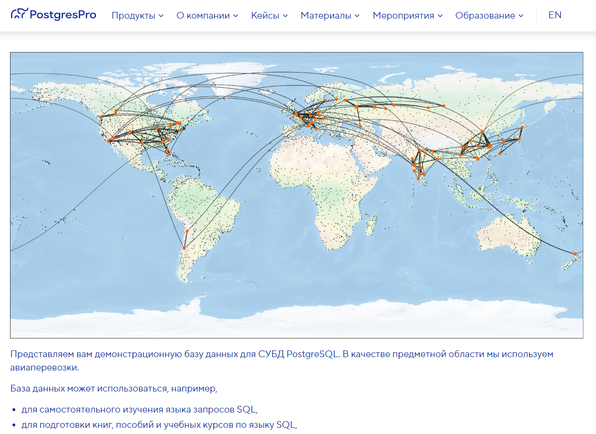

# Секционирование таблицы // ДЗ 11

## 0. Постановка задачи
Цель: научиться выполнять секционирование таблиц в PostgreSQL; повысить производительность запросов и упростив управление данными;

Описание/Пошаговая инструкция выполнения домашнего задания:
На основе готовой базы данных примените один из методов секционирования в зависимости от структуры данных.
https://postgrespro.ru/education/demodb

Шаги выполнения домашнего задания:
1.Анализ структуры данных:
Ознакомьтесь с таблицами базы данных, особенно с таблицами bookings, tickets, ticket_flights, flights, boarding_passes, seats, airports, aircrafts.
Определите, какие данные в таблице bookings или других таблицах имеют логическую привязку к диапазонам, по которым можно провести секционирование (например, дата бронирования, рейсы).

2.Выбор таблицы для секционирования:
Основной акцент делается на секционировании таблицы bookings. Но вы можете выбрать и другие таблицы, если видите в этом смысл для оптимизации производительности (например, flights, boarding_passes).
Обоснуйте свой выбор: почему именно эта таблица требует секционирования? Какой тип данных является ключевым для секционирования?

3.Определение типа секционирования:
Определитесь с типом секционирования, которое наилучшим образом подходит для ваших данных:
По диапазону (например, по дате бронирования или дате рейса).
По списку (например, по пунктам отправления или по номерам рейсов).
По хешированию (для равномерного распределения данных).

4.Создание секционированной таблицы:
Преобразуйте таблицу в секционированную с выбранным типом секционирования.
Например, если вы выбрали секционирование по диапазону дат бронирования, создайте секции по месяцам или годам.

5.Миграция данных:
Перенесите существующие данные из исходной таблицы в секционированную структуру.
Убедитесь, что все данные правильно распределены по секциям.

6.Оптимизация запросов:
Проверьте, как секционирование влияет на производительность запросов. Выполните несколько выборок данных до и после секционирования для оценки времени выполнения.
Оптимизируйте запросы при необходимости (например, добавьте индексы на ключевые столбцы).

7.Тестирование решения:
Протестируйте секционирование, выполняя несколько запросов к секционированной таблице.
Проверьте, что операции вставки, обновления и удаления работают корректно.

8.Документирование:
Добавьте комментарии к коду, поясняющие выбранный тип секционирования и шаги его реализации.
Опишите, как секционирование улучшает производительность запросов и как оно может быть полезно в реальных условиях.

Формат сдачи:
SQL-скрипты с реализованным секционированием.
Краткий отчет с описанием процесса и результатами тестирования.
Пример запросов и результаты до и после секционирования.

----

## 1. Установка демо базы и предварительный анализ

Для выполнения задания воспользуемся демонстрационной базой данных авиаперевозок.
https://postgrespro.ru/education/demodb
возьмем минимальный вариант - данные по полётам за три месяца (размер БД примерно 1,3 Гбайт),



Скачиваем и разворачиваем дамп базы.

```sh
gunzip -c /mnt/c/WSL/demo-20250901-3m.sql.gz | sudo -u postgres psql -h localhost -p 5433
```

Методом проб узнаем, что нам дополнительно потребуется сгенерировать локаль. 
Делаем это, и перезапускаем базу. 

```sh
sudo locale-gen en_US.UTF-8
sudo pg_ctlcluster 17 main restart
pg_lsclusters
gunzip -c /mnt/c/WSL/demo-20250901-3m.sql.gz | sudo -u postgres psql -h localhost -p 5433
```

Удачно. Цепляемся к базе. Смотрим список таблиц, текущую версию.
Анализируем кандидата на секционирование таблицу bookings.

```sql
sudo -u postgres psql -h localhost -p 5433 -d demo

demo=# \dt
               List of relations
  Schema  |      Name       | Type  |  Owner
----------+-----------------+-------+----------
 bookings | airplanes_data  | table | postgres
 bookings | airports_data   | table | postgres
 bookings | boarding_passes | table | postgres
 bookings | bookings        | table | postgres
 bookings | flights         | table | postgres
 bookings | routes          | table | postgres
 bookings | seats           | table | postgres
 bookings | segments        | table | postgres
 bookings | tickets         | table | postgres


demo=# SELECT bookings.version();
             version
----------------------------------
 PostgresPro 2025-09-01 (91 days)

demo=# select count(1) from bookings;
  count
---------
 1292893

demo=# \d+ bookings
                                                        Table "bookings.bookings"
    Column    |           Type           | Collation | Nullable | Default | Storage  | Compression | Stats target |     Description
--------------+--------------------------+-----------+----------+---------+----------+-------------+--------------+----------------------
 book_ref     | character(6)             |           | not null |         | extended |             |              | Booking number
 book_date    | timestamp with time zone |           | not null |         | plain    |             |              | Booking date
 total_amount | numeric(10,2)            |           | not null |         | main     |             |              | Total booking amount
Indexes:
    "bookings_pkey" PRIMARY KEY, btree (book_ref)
Referenced by:
    TABLE "tickets" CONSTRAINT "tickets_book_ref_fkey" FOREIGN KEY (book_ref) REFERENCES bookings(book_ref)
Access method: heap
```

В таблице бронирования bookings 1.2 миллиона записей, имеется колонка даты book_date по которой удобно делать секционирование,
так как бронирования естественным образом распределены во времени.
При этом мы знаем, что у нас версия базы имеет 3 месяца данных, по которым ожидается 3 основные партиции.
Секционирование по book_date позволит базе читать только нужные секции, а не всю таблицу.
Появится возможность при необходимости быстро архивировать устаревшие данные путём отсоединения секции, не затрагивая остальные.

Итого, выбираем диапазонный тип секционирования RANGE по ключу — book_date, гранулярность — месяц.

## 2. Создание секционированной таблицы и миграция

Создадим секционированную таблицы, на основе имеющейся.
Первичный ключ секционированной таблицы обязан включать ключ секционирования. Поэтому в новой таблице первичный ключ будет составным: (book_ref, book_date). 

При этом из проведенного анализа мы знаем что внешний ключ из tickets в ссылается только на book_ref нашей таблицы, по этому при переходе на секционированную таблицу его потребуется либо удалить и либо пересоздать с составным ключом. 
В нашем случае удалим его перед началом миграции, иначе существующие связи не позволят произвести замену таблиц.

```sql
-- Переключаемся в схему bookings демо-базы
SET search_path TO bookings;

-- Создаём новую секционированную таблицу с той же структурой что и оригинал,
-- но с составным первичным ключом (book_ref, book_date).
CREATE TABLE bookings_part (
    book_ref     char(6)      NOT NULL,
    book_date    timestamptz  NOT NULL,
    total_amount numeric(10,2) NOT NULL,
    PRIMARY KEY (book_ref, book_date)
) PARTITION BY RANGE (book_date);
```

Перед созданием партиций проверим диапазон данных в первичной таблице.

```sql
demo=# select min(book_date), max(book_date) from bookings;
              min              |              max
-------------------------------+-------------------------------
 2025-09-01 05:00:06.265219+05 | 2025-12-01 04:59:28.616825+05
(1 row)
```

Действительно мы имеем данные за три месяца. 
Переходим к секционированию.

```sql
-- создадим 3 партиции за 3 месяца 2025 года 
CREATE TABLE bookings_2025_09 PARTITION OF bookings_part
    FOR VALUES FROM ('2025-09-01') TO ('2025-10-01');
CREATE TABLE bookings_2025_10 PARTITION OF bookings_part
    FOR VALUES FROM ('2025-10-01') TO ('2025-11-01');
CREATE TABLE bookings_2025_11 PARTITION OF bookings_part
    FOR VALUES FROM ('2025-11-01') TO ('2025-12-01');
-- плюс DEFAULT-секция для записей вне явно заданных диапазонов
CREATE TABLE bookings_default PARTITION OF bookings_part DEFAULT;
```

Приступим к миграции данных. перенесем данные и подменим таблицы.

```sql
-- Освобождаем зависимость от внешнего ключа
ALTER TABLE tickets DROP CONSTRAINT IF EXISTS tickets_book_ref_fkey;

-- Копируем данные из старой таблицы в секционированную
INSERT INTO bookings_part (book_ref, book_date, total_amount)
SELECT book_ref, book_date, total_amount
FROM bookings;

-- Переименовываем старую таблицу (сохраняем как резервную) и вводим новую
ALTER TABLE bookings RENAME TO bookings_old;
ALTER TABLE bookings_part RENAME TO bookings;
```

Проведем оптимизацию, добавив вспомогательные индексы.
Контроль уникальности только по book_ref на секционированной по дате таблице невозможен,
поэтому для ускорения поиска по номеру брони создан обычный индекс.

```sql
-- Индекс по ключу секционирования 
CREATE INDEX idx_bookings_book_date ON bookings (book_date);

-- Дополнительный индекс по старому первичному ключу book_ref
CREATE INDEX idx_bookings_book_ref ON bookings (book_ref);
```

## 3. Тестирование внесенных изменений

```sql
--Проверка распределения данных по секциям
SELECT tableoid::regclass AS partition, count(*)
FROM bookings
GROUP BY tableoid
ORDER BY partition;

    partition     | count
------------------+--------
 bookings_2025_09 | 445102
 bookings_2025_10 | 434381
 bookings_2025_11 | 410733
 bookings_default |   2677
(4 rows)
```

Результат корректный, каждая месячная секция содержит строки только за свой диапазон.
Данные равномерно распределены.
Крайние значение за 2025_12 не попавшие в основные партиции оказались в bookings_default.

Посмотрим планы различных выборок в старой и новой секционированной таблице.

```sql
-- проверка 1. Количество бронирований за конкретный месяц
-- ДО
EXPLAIN ANALYZE
SELECT count(*) FROM bookings_old
WHERE book_date >= '2025-10-01' AND book_date < '2025-11-01';

                                                                              QUERY PLAN                                                                            
----------------------------------------------------------------------------------------------------------------------------------------------------------------------
 Finalize Aggregate  (cost=17769.91..17769.92 rows=1 width=8) (actual time=148.248..152.883 rows=1 loops=1)
   ->  Gather  (cost=17769.69..17769.90 rows=2 width=8) (actual time=148.151..152.877 rows=3 loops=1)
         Workers Planned: 2
         Workers Launched: 2
         ->  Partial Aggregate  (cost=16769.69..16769.70 rows=1 width=8) (actual time=139.449..139.450 rows=1 loops=3)
               ->  Parallel Seq Scan on bookings_old  (cost=0.00..16320.58 rows=179645 width=0) (actual time=0.214..134.720 rows=144794 loops=3)
                     Filter: ((book_date >= '2025-10-01 00:00:00+05'::timestamp with time zone) AND (book_date < '2025-11-01 00:00:00+05'::timestamp with time zone))
                     Rows Removed by Filter: 286171
 Planning Time: 0.131 ms
 Execution Time: 152.934 ms

-- ПОСЛЕ
EXPLAIN ANALYZE
SELECT count(*) FROM bookings
WHERE book_date >= '2025-10-01' AND book_date < '2025-11-01';

                                                                              QUERY PLAN                                                                            
----------------------------------------------------------------------------------------------------------------------------------------------------------------------
 Finalize Aggregate  (cost=8238.68..8238.69 rows=1 width=8) (actual time=28.870..30.954 rows=1 loops=1)
   ->  Gather  (cost=8238.57..8238.68 rows=1 width=8) (actual time=28.771..30.950 rows=2 loops=1)
         Workers Planned: 1
         Workers Launched: 1
         ->  Partial Aggregate  (cost=7238.57..7238.58 rows=1 width=8) (actual time=27.116..27.116 rows=1 loops=2)
               ->  Parallel Seq Scan on bookings_2025_10 bookings  (cost=0.00..6599.77 rows=255518 width=0) (actual time=0.007..19.802 rows=217190 loops=2)
                     Filter: ((book_date >= '2025-10-01 00:00:00+05'::timestamp with time zone) AND (book_date < '2025-11-01 00:00:00+05'::timestamp with time zone))
 Planning Time: 1.678 ms
 Execution Time: 31.185 ms
``` 

```sql
--проверка 2. Сумма выручки по месяцам 
-- ДО
EXPLAIN ANALYZE
SELECT date_trunc('month', book_date) AS mon, sum(total_amount)
FROM bookings_old
GROUP BY mon ORDER BY mon;

                                                              QUERY PLAN
--------------------------------------------------------------------------------------------------------------------------------------
 GroupAggregate  (cost=177739.34..206829.43 rows=1292893 width=40) (actual time=738.963..871.452 rows=4 loops=1)
   Group Key: (date_trunc('month'::text, book_date))
   ->  Sort  (cost=177739.34..180971.57 rows=1292893 width=14) (actual time=669.302..749.412 rows=1292893 loops=1)
         Sort Key: (date_trunc('month'::text, book_date))
         Sort Method: external merge  Disk: 30576kB
         ->  Seq Scan on bookings_old  (cost=0.00..24401.16 rows=1292893 width=14) (actual time=37.875..265.484 rows=1292893 loops=1)
 Planning Time: 0.631 ms
 JIT:
   Functions: 7
   Options: Inlining false, Optimization false, Expressions true, Deforming true
   Timing: Generation 2.332 ms (Deform 0.695 ms), Inlining 0.000 ms, Optimization 2.976 ms, Emission 34.449 ms, Total 39.757 ms
 Execution Time: 1026.812 ms

-- ПОСЛЕ
EXPLAIN ANALYZE
SELECT date_trunc('month', book_date) AS mon, sum(total_amount)
FROM bookings
GROUP BY mon ORDER BY mon;

                                                                                 QUERY PLAN                                                                         
----------------------------------------------------------------------------------------------------------------------------------------------------------------------------
 Finalize GroupAggregate  (cost=24142.30..24194.97 rows=200 width=40) (actual time=273.090..277.774 rows=4 loops=1)
   Group Key: (date_trunc('month'::text, bookings.book_date))
   ->  Gather Merge  (cost=24142.30..24188.97 rows=400 width=40) (actual time=273.082..277.763 rows=7 loops=1)
         Workers Planned: 2
         Workers Launched: 2
         ->  Sort  (cost=23142.27..23142.77 rows=200 width=40) (actual time=260.642..260.644 rows=2 loops=3)
               Sort Key: (date_trunc('month'::text, bookings.book_date))
               Sort Method: quicksort  Memory: 25kB
               Worker 0:  Sort Method: quicksort  Memory: 25kB
               Worker 1:  Sort Method: quicksort  Memory: 25kB
               ->  Partial HashAggregate  (cost=23131.63..23134.63 rows=200 width=40) (actual time=260.622..260.625 rows=2 loops=3)
                     Group Key: (date_trunc('month'::text, bookings.book_date))
                     Batches: 1  Memory Usage: 40kB
                     Worker 0:  Batches: 1  Memory Usage: 40kB
                     Worker 1:  Batches: 1  Memory Usage: 40kB
                     ->  Parallel Append  (cost=0.00..20438.10 rows=538706 width=14) (actual time=0.365..200.029 rows=430964 loops=3)
                           ->  Parallel Seq Scan on bookings_2025_09 bookings_1  (cost=0.00..6108.81 rows=261825 width=14) (actual time=0.052..69.653 rows=148367 loops=3)
                           ->  Parallel Seq Scan on bookings_2025_10 bookings_2  (cost=0.00..5960.98 rows=255518 width=14) (actual time=0.007..82.266 rows=434381 loops=1)
                           ->  Parallel Seq Scan on bookings_2025_11 bookings_3  (cost=0.00..5637.10 rows=241608 width=14) (actual time=0.057..124.540 rows=205366 loops=2)
                           ->  Parallel Seq Scan on bookings_default bookings_4  (cost=0.00..37.68 rows=1575 width=14) (actual time=1.022..3.456 rows=2677 loops=1)
 Planning Time: 1.097 ms
 Execution Time: 277.852 ms
```

```sql
-- проверка 3. Последние 10 бронирований за конкретный период
-- ДО
EXPLAIN ANALYZE
SELECT book_ref, book_date, total_amount
FROM bookings_old
WHERE book_date >= '2025-11-01' AND book_date < '2025-12-01'
ORDER BY book_date DESC
LIMIT 10;

                                                                              QUERY PLAN                                                                            
----------------------------------------------------------------------------------------------------------------------------------------------------------------------
 Limit  (cost=21030.44..21031.61 rows=10 width=21) (actual time=45.570..47.886 rows=10 loops=1)
   ->  Gather Merge  (cost=21030.44..61090.74 rows=343350 width=21) (actual time=45.569..47.882 rows=10 loops=1)
         Workers Planned: 2
         Workers Launched: 2
         ->  Sort  (cost=20030.42..20459.60 rows=171675 width=21) (actual time=38.128..38.129 rows=8 loops=3)
               Sort Key: book_date DESC
               Sort Method: top-N heapsort  Memory: 26kB
               Worker 0:  Sort Method: top-N heapsort  Memory: 26kB
               Worker 1:  Sort Method: top-N heapsort  Memory: 26kB
               ->  Parallel Seq Scan on bookings_old  (cost=0.00..16320.58 rows=171675 width=21) (actual time=0.382..29.143 rows=136911 loops=3)
                     Filter: ((book_date >= '2025-11-01 00:00:00+05'::timestamp with time zone) AND (book_date < '2025-12-01 00:00:00+05'::timestamp with time zone))
                     Rows Removed by Filter: 294053
 Planning Time: 0.074 ms
 Execution Time: 47.903 ms

-- ПОСЛЕ
EXPLAIN ANALYZE
SELECT book_ref, book_date, total_amount
FROM bookings
WHERE book_date >= '2025-11-01' AND book_date < '2025-12-01'
ORDER BY book_date DESC
LIMIT 10;

                                                                                     QUERY PLAN                                                                     
------------------------------------------------------------------------------------------------------------------------------------------------------------------------------------
 Limit  (cost=0.42..0.81 rows=10 width=21) (actual time=0.006..0.013 rows=10 loops=1)
   ->  Index Scan Backward using bookings_2025_11_book_date_idx on bookings_2025_11 bookings  (cost=0.42..15997.91 rows=410733 width=21) (actual time=0.006..0.011 rows=10 loops=1)
         Index Cond: ((book_date >= '2025-11-01 00:00:00+05'::timestamp with time zone) AND (book_date < '2025-12-01 00:00:00+05'::timestamp with time zone))
 Planning Time: 0.120 ms
 Execution Time: 0.021 ms
```

В итоге имеем следующее:
| | bookings_old | bookings |
| :--- | ---: | ---: |
| Запрос 1 | 152.934 ms | 31.185 ms |
| Запрос 2 | 1026.812 ms | 277.852 ms |
| Запрос 3 | 47.903 ms | 0.021 ms |

получено ускорение в 4-5 раз в первых выборках и в тысячи раз в третьей выборке. 
первый и второй случай использует Parallel Seq Scan в нужных партициях,
в третьем случае удачно попадаем в Index Scan bookings_2025_11_book_date_idx созданный в нужной партиции bookings_2025_11,
который дает колоссальный прирост в скорости.

Далее проверим, что операции вставки, обновления и удаления работают в новой таблице корректно.

```sql
-- добавляем строку - строка остается в ожидаемой секции
INSERT INTO bookings (book_ref, book_date, total_amount)
VALUES ('TST001', '2025-10-15 12:00:00+05', 100.00);

SELECT tableoid::regclass AS partition, book_ref, book_date, total_amount
FROM bookings WHERE book_ref = 'TST001';
-- Ожидаем: bookings_2025_10

    partition     | book_ref |       book_date        | total_amount
------------------+----------+------------------------+--------------
 bookings_2025_10 | TST001   | 2025-10-15 12:00:00+05 |       100.00

-- меняем сумму - строка остается в текущей секции
UPDATE bookings SET total_amount = 101.00
WHERE book_ref = 'TST001';

SELECT tableoid::regclass AS partition, total_amount
FROM bookings WHERE book_ref = 'TST001';
-- Ожидаем: bookings_2025_10, total_amount = 101.00

    partition     | total_amount
------------------+--------------
 bookings_2025_10 |       101.00

-- меняющий ключ секционирования — строка переедет в другую секцию
UPDATE bookings SET book_date = '2025-11-05 09:00:00+05'
WHERE book_ref = 'TST001';

SELECT tableoid::regclass AS partition, book_date
FROM bookings WHERE book_ref = 'TST001';
-- Ожидаем: bookings_2025_11 

    partition     |       book_date
------------------+------------------------
 bookings_2025_11 | 2025-11-05 09:00:00+05

-- удаление строк
DELETE FROM bookings
WHERE book_ref = 'TST001';

SELECT count(*) FROM bookings WHERE book_ref = 'TST001';

 count
-------
     0
```

Все операции отрабатывают без ошибок.

## 4. Выводы

В ходе работы: 
Проанализирована структура bookings, 
Выбрано диапазонное секционирование по book_date с помесячными секциями,
Создана секционированная таблица bookings_part с тремя основными секциями,
Удален внешний ключ, который конфликтует с новой структурой,
Данные мигрированы из исходной таблицы,
Исходная таблица сохранена как архивная, 
Созданы новые индексы на секционированной таблице, 
Проверено распределение данных в новой таблице,
Проанализированы планы таблиц до и после секционирования,
Проверена корректность работы основных операций при работе с новой таблицей.
Наблюдается значительное ускорение запросов, что говорит о корректном выборе метода секционирования.
